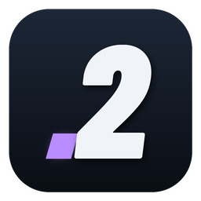
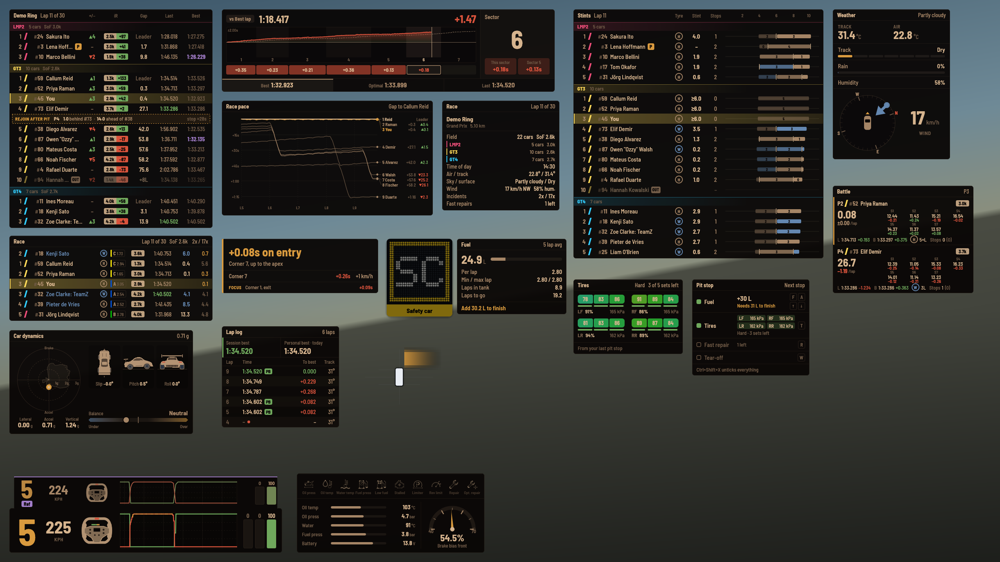
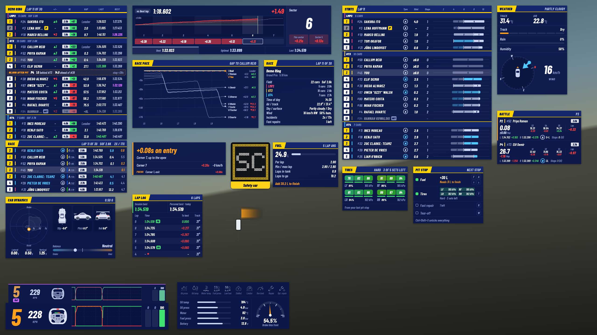
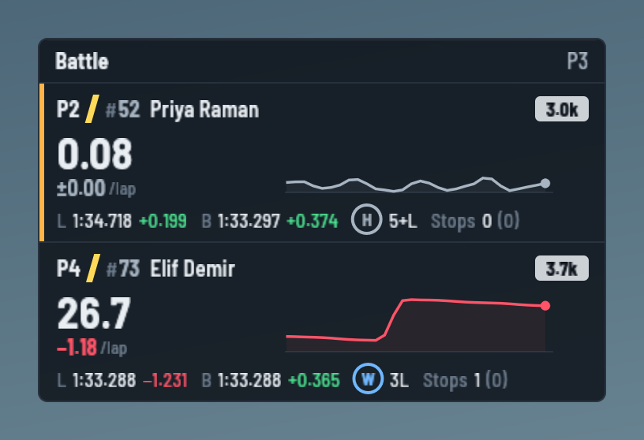
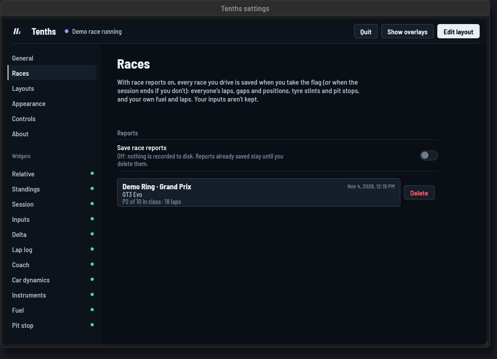
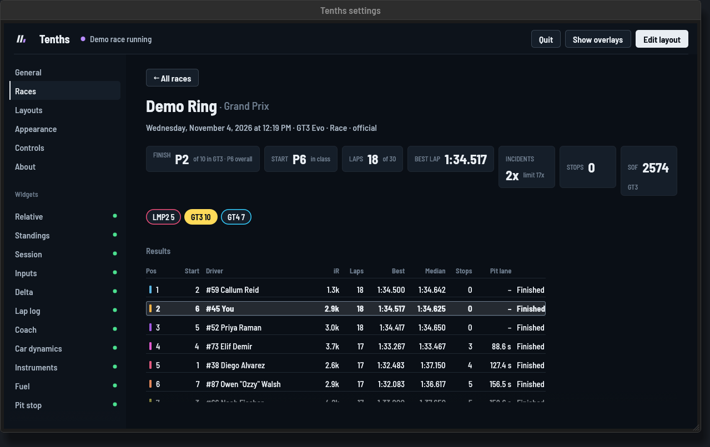

# 2Tenths (In Active Development)

iRacing overlays you own. 2Tenths is a native Windows app, written in Rust and
drawn with [egui](https://github.com/emilk/egui), that reads the iRacing SDK
directly and draws a set of configurable widgets over the sim: no
subscriptions, no third-party services, and every line of it is yours to change.

It runs as one small program with each widget in its own small window over the game, so iRacing gives up as little
as possible to it.

Everything here has been developed in about 4 days. Any bugs or requested features can be added quickly.

*2Tenths used to be called Tenths: same app, same settings, new name.*

**From 0.6 on, 2Tenths is a new app.** Versions up to 0.4.13 were built with
Tauri, with every widget drawn as a web page. That used a lot more memory, kept
growing over a long session and cost noticeable frame rate in iRacing. 0.6 is
a rewrite of the same app in Rust and egui, drawn natively: same widgets, same
settings window, same keys, a fraction of the memory and CPU. Your settings,
layouts, laps, ratings and race reports carry straight over, and a 0.4 install
updates itself to it from its own **Update** button. The Tauri version is kept
as it was in [`archive/tauri/`](archive/tauri) and on the `archive/tauri`
branch.

Note: This is in active development, progressing quickly. I am trying to provide a free, open-source but still useful tool. There may (read: will) be bugs. If you find a problem or have suggestions open an Issue.


All 18 widgets at once, in the demo race on a 2560×1440 screen. The default
layout turns on fewer, and you can place each one wherever you like.

<details>
<summary>The same layout in the light theme</summary>


</details>

<details>
<summary>The same layout in the Box Box theme</summary>


</details>

<details>
<summary>The same layout in the Night theme</summary>



</details>

<details>
<summary>The same layout in the '90s theme</summary>



</details>

## Features

- **18 widgets**: timing tables, a battle view of the cars around you, a race pace chart, everyone's stints, a lap
  delta graph, a lap log, live coaching, inputs, car dynamics, dash lights, fuel, tires, pit stop,
  weather, a radar and an LED flag board. Each one has its own options.
- **Pit stop controls**: tick fuel (enough to finish, a full tank, or a few
  litres more or less, or let auto fuel keep it at enough to finish), tires, fast repair and a tear-off for your next stop
  without opening iRacing's pit menu, and see what iRacing has ticked.
- **Your keys, your wheel buttons**: every shortcut can be changed, and any
  action can also go on a button on your wheel, button box or gamepad.
- **Edit layout mode**: drag any widget anywhere, resize it, snap it to the
  screen edges and other widgets, and turn widgets on or off from the edit bar.
- **Any screen**: with more than one monitor, put each widget on whichever
  display you like; drag it across in edit mode.
- **Saved layouts**: keep as many layouts as you like (sprint, endurance,
  night…), switch with `Ctrl+Shift+L`, `Ctrl+Shift+1`–`9` or a wheel
  button, and export them as files to back up or share.
- **Any screen size**: widgets are pinned to the nearest screen edge or the
  centre, so a layout made at 1080p lands in the same places at 1440p or 4K.
- **Five themes**: dark, light, Night (dim and warm, for racing in the dark),
  Box Box (panels styled like a TV timing tower) and '90s (yellow and white on
  deep blue, like the TV graphics of the time), with a color picker for every color the overlays use, kept
  separately for each theme.
- **Reference laps and coaching**: import iRacing's `.blap`/`.olap` best laps or
  any lap from an `.ibt` telemetry file, then compare against it live with the
  delta graph, ghost inputs and live coaching cues.
- **Lap history**: every lap is logged with whether it was clean, and your
  personal best for each car and track is saved between sessions.
- **Strength of field** worked out with iRacing's own formula, per class, and
  each driver's **estimated iRating change** in the Standings during official
  races.
- **Race awareness**: the tyre compound every car is on, places gained and lost,
  pit and retirement symbols, where you'd rejoin after a stop, and your
  incidents against the next limit (including limits that move on after a
  penalty).
- **Rate drivers**: after the chequered flag, give other drivers a thumbs up or
  down; a small thumb shows by their name in later races.
- **Click-through**: the overlay never takes the mouse from iRacing, except
  while you're editing the layout or over the rating thumbs after a race.
- **A demo race** with 21 cars in three classes, so you can set everything up
  without iRacing running.
- **Light on the sim**: native drawing in one process, a small window per
  widget, and a redraw rate you can lower (`--fps`).

## Widgets

Every widget can be shown or hidden, resized from 50% to 300%, faded, and moved
anywhere. Options are under **Settings → (widget name)**.

### Relative


The cars just ahead of and behind you on track, with the time gap to each. Cars
a lap up on you are orange, cars you're lapping are blue. Each row has the
class color, car number, license and safety rating, iRating and last lap. A
last lap is purple when it's the fastest in class and green when it's that
driver's personal best. The last column is each car's gap to the car directly
in front of it on track (yours included), amber when it's under a second, so
you can see the fights going on around you. A car in the pit lane has an
outlined **P** next to its name, and a solid **P** once it's stopped in its
pit box. Cars that have left the sim aren't on track, so they drop out of the
relative. The header shows the lap count and your class's strength of field. When
there's a choice of tyres, a badge shows the compound each car is on (W wet, S
soft, M medium, H hard).

The header also shows your incidents against the limit, for example **4x /
17x**: amber from three quarters of the way, red within 4x. In series that
give a penalty at the limit and carry on, the limit moves on after it (18x /
21x, then 25x…); how many incidents apart those are is set in the widget's
options (4 by default, 0 when the limit is the end).

*Options*: how many cars ahead and behind, and whether to show iRating,
license, last lap, the gap to the car ahead, cars in the pits and SoF, when to show
the tyre column, incidents, and the step between penalties after the limit.

### Standings


The race order grouped by class, with each class's car count and strength of
field. Your class shows more rows, and you're always kept in view. Gaps are to
the class leader or to the car ahead, with iRating, last and best laps.

In races, the **+/−** column shows how many places each car has gained (green
▲) or lost (red ▼) in its class since the start. The grid is the order on
track before the green flag; if you join a race already under way, the
qualifying order stands in.

In official races, each driver's iRating badge also shows their estimated
gain (green) or loss (red) if the race finished as it stands, worked out within
each class. iRacing doesn't
publish its formula, so this uses the community calculator other overlays use
(the "iRacing SOF iRating Calculator"); it's usually within a few points.

**Rate drivers.** Once you've taken the chequered flag, a **Rate** column
appears with a thumbs up and a thumbs down by every other driver. They're
white until you click one, then green or red; click it again to clear it.
Clicking works without edit mode: the overlay takes the mouse only while it's
over the thumbs, so everything else still goes to iRacing. Ratings are kept in
`driver-ratings.json` and, in later sessions, a small green or red thumb sits
next to that driver's name in the Standings and the Relative.


Next to the name, an outlined **P** means the car is in the pit lane and a
solid **P** that it's stopped in its pit box. A car that has left the sim gets
**OUT** in a race (retired, quit or towed to the garage) and **GAR** in
practice and qualifying, and its row fades.

**Rejoin after pit** (races): once a few pit stops have been timed this session, a
dashed line in your class shows where you'd come out if you pitted now: the
position, how far behind the car ahead you'd be and how far ahead of the car
behind. 2Tenths times every car's stops (pit entry to exit, minus the time
the same stretch takes at racing speed) and uses your class's average, so
nothing shows until at least two real stops in your class have been timed.
Drive-throughs, tows, resets to the pits and unusually long or short stops are
left out. The estimate
assumes a typical stop; a longer fuel fill or repairs mean you'd come out
further back. It's hidden while you're in the pit lane.

*Options*: rows for your class and for others, your class only, gap to leader
or interval, which columns to show (including places gained or lost), and the
pit rejoin line.

### Session


Everything about the event in one panel: track and length, field size with
cars and SoF per class, time of day, air and track temperature, sky, track
wetness, wind and humidity. At the bottom are your incidents against the limit
(amber from 75% of it) and how many fast repairs are left. Off by default.

*Options*: list each class, show conditions, show incidents and fast repairs.

### Delta


Your lap against a comparison lap, all the way round. The line rises where the
comparison lap is faster and dips where you are, so red above the line is time
lost and green below it is time gained. Last lap's line is dashed behind it.
Below that, each sector's gain or loss, and on the right the sector you're in.
Your best, optimal and last laps run along the bottom, with the comparison lap
highlighted.

Compare against your best lap, optimal lap (best sectors), session best,
session optimal, last lap, or an imported reference lap. Best and optimal are
your all-time ones in practice and this session's in qualifying and races.
Where iRacing gives no delta (it doesn't in races), 2Tenths works it out from
your own laps this session.

*Options*: comparison lap, iRacing's sectors or 4–30 equal mini sectors, last
lap's line, the lap times row, and a **simple pace readout** that swaps the
graph for one big number: how far ahead or behind you are right now.

### Race pace


Everyone in your class against the class leader, through the race. The
leader is the flat line along the top; every other car is a line below it at
its gap to the leader, live. A line that slopes down is a car slower than the
leader, one that rises is catching, and the steeper it is the bigger the
difference in pace, so you can see at a glance who is quick, who is fading
and where the fights are. You're picked out in amber. Down the right, each
car's position, gap and how much the gap changed over the leader's last lap
(green when it's catching, red when it's dropping back). Lapped and retired
cars run along the bottom so they don't squash everyone else. Dotted lines
mark the leader's laps. The history starts when the race does (or when
2Tenths starts, if that's later) and is kept while the widget is hidden. Races
only; off by default.

*Options*: the whole race or the leader's last 3, 5, 10 or 20 laps (5 to
start with); relative to you instead of the leader (you along the middle, and the
nearest cars on the road either side of you, as on the Relative, at their live
gap to you on track: pass someone and the lines change at once, and the figure
by each name is how much you gained on them over your last lap); everyone in your class or just
the leader and the cars around you; a fixed gap scale; and the gap change per
lap.

### Stints


Every driver's stints, grouped by class in race order. **Stint** is how many
laps they've done since their last stop, live; **Tyre** the compound they're
on (shown when the car has more than one), and **Stops** how many times
they've been into the pit lane. The timeline runs across the whole session:
each stint is a bar coloured by compound (wets blue, softs red, mediums
yellow, hards light), with its length in laps written on it and a tick at
every stop, so you can see who's due in, who's gone long and who's switched
to wets. A ✕ marks a car that retired.

iRacing doesn't publish stints, so 2Tenths works them out from each car's
pit-lane visits and laps, from when it first sees the session. A stint it
only saw part of is faded and its length shown as "≥". It can't tell whether
another car changed tyres at a stop, only what compound it's on, so a
fuel-only stop still starts a new stint. Off by default.

*Options*: all classes or just yours, rows for your class and for others,
the timeline, stint lengths on it, and when to show the tyre column.

### Lap log


Every lap this session, newest first, with its gap to your best and the track
temperature when you set it. Your session best is green. A red dot marks a lap
that wasn't clean (off track or an incident), "Pit" marks in and out laps, and
"PB" marks a lap that beat your all-time personal best. The header shows the
session best and your personal best for this car and track, with when you set
it. It shows 8 laps; older ones scroll below, with a fade at the bottom when
there are more. While you drive the overlay lets the mouse through to the
game, so scroll the list in edit layout mode.

*Options*: how many laps to show before the list scrolls, gap to session best
or to personal best, and the gap, temperature and fuel-used columns.

### Coach


One live cue at a time from an imported reference lap: brake or lift in 50 m,
brake now, you're braking early, brake harder or lighter (measured from your
own brake point, so braking late isn't mistaken for braking lightly), trail
the brake, carry more speed, throttle now, gear at the apex, turn in more, and
whether you're gaining or losing. As you leave each corner it gives a verdict:
the time you gained or lost there and the main reason, like "Braked 20 m
early" or "Throttle earlier". Below it, your gap to the reference and your
speed difference, and the focus corner: the one costing you most on average,
and why. Corners where you're consistently on pace stop getting minor cues,
and coaching pauses under yellow and off track. Only shown while a reference
lap for this track is loaded.

*Options*: show the reason line, the gap and speed, and the focus corner.

### Inputs


Gear, speed, a steering wheel that turns with yours, a scrolling throttle and
brake trace, and throttle, brake and clutch bars. The gear turns red at the
shift point. When ABS is working the brake trace turns amber and the brake bar
shows an ABS tag. With a reference lap loaded, a slimmer strip above shows the
reference's gear, speed, pedals and (for `.ibt` laps) wheel at the same spot on
track. If there's no room above the widget on screen, the strip goes below it.


The wheel comes in four styles: round (road cars), GT, formula and oval. The
GT and formula wheels have shift lights that fill green, amber and red as you
near the shift point. *Automatic* picks one from the car's name (formula and
prototype cars get the formula wheel, GT cars the GT wheel, stock cars and
short-track cars the oval wheel, anything else the round one).

*Options*: trace length, wheel style, and whether to show the trace, wheel,
clutch, shift light and reference strip.

### Car dynamics


A g-meter with the grip you've been using drawn around it: each point of the
outline holds for 10 seconds, then shrinks back to the centre over the next
10, so it shows recent grip and fades away on the straights. Beside it are the
lateral, longitudinal and vertical g, top, side and rear views of the car
showing slip, pitch and roll, and a balance bar estimating understeer or
oversteer from how the car rotates for the steering you put in.

*Options*: g-meter range, how long the grip outline holds and how quickly it
shrinks back to the centre, which way the dot moves, slip/pitch/roll views and
how much to exaggerate them, and the balance bar. With the views and the
balance bar both off, it's just a narrow g-meter.

### Instruments


Dash lights for every iRacing engine warning (oil and fuel pressure, oil and
water temperature, stalled, pit limiter, rev limiter, repairs) plus a low fuel
light, engine gauges, and a brake bias dial that flashes when you change it.

*Options*: engine gauges, brake bias, and a bulb test that lights every warning
while editing.

### Fuel


Fuel in the tank, use per lap (the average of your last 5 green laps), laps
the tank will last, laps to go, and how much to add at your stop to finish.
A "Min / max lap" row shows the least and most you've used on any clean green lap of the session.
In timed races, laps to go runs until the overall leader takes the flag (the
white flag once the clock runs out, then one more lap), so it never leaves you
a lap short if you're behind the leader.

*Options*: a safety margin in laps.

### Weather


Track and air temperature, how wet the track is (iRacing's seven steps from
dry to extremely wet), rain, humidity and fog, with arrows showing which way
each has moved over the last three minutes. Below, a wind compass that turns
with your car: the car always points up and the arrow shows where the wind is
hitting you from, with the wind speed beside it. iRacing
doesn't publish a forecast or rain radar, so the trend arrows are the closest
thing to one. Wind is measured at the start/finish line. Off by default.

*Options*: show the compass, turn it with the car or keep north up, and the
trend arrows.

### Tires


Temperature across each tire (inside, middle, outside), tread left, cold
pressures, the compound and how many sets you have left.

*Options*: show cold pressure.

### Pit stop


What iRacing will do at your next stop, and keys or wheel buttons to change it
while you drive. Each one changes one item in iRacing's pit menu. These are the
default keys; put them on other keys or on buttons in
[Settings → Controls](#controls):

| Default key          | Does |
| -------------------- | ---- |
| `Ctrl + Shift + F`   | Fuel: the amount to finish (from the Fuel widget, with its safety margin), or a full tank. Press again to untick it, or to update it once the amount has changed. |
| `Ctrl + Shift + ↑` `↓` | A few litres more or less (5 by default). Quick presses add up. |
| `Ctrl + Shift + A`   | Auto fuel to finish, on or off (see below) |
| `Ctrl + Shift + T`   | All four tires, or untick them |
| `Ctrl + Shift + R`   | Fast repair |
| `Ctrl + Shift + W`   | Windscreen tear-off |
| `Ctrl + Shift + X`   | Untick everything |

iRacing never confirms a command, so each row shows what iRacing reports as
ticked, not what was asked for. The fuel line turns amber when the amount
ticked doesn't match what you need. Pressures are the ones iRacing will set,
and the header says if you've stopped too far from your box. The keys and
buttons only work while this widget is on and you're in the car, so they don't
take `Ctrl+Shift+T` and the rest from other programs the rest of the time. Each
row shows its key, or its wheel button if it has one, and lights it up for a
moment when you press it. Off by default.

**Auto fuel to finish.** With it on, 2Tenths keeps iRacing's fuel amount at
what you need to finish (from the Fuel widget, with its safety margin),
updating it as the estimate changes, so whenever you box the amount is already
right. It only changes the amount when it's a litre or more out, at most every
10 seconds, and not while you're in the pit lane. The fuel row shows **AUTO**.
Changing the fuel with more or less, or unticking everything, pauses it (AUTO
goes grey) so it doesn't fight you; the fuel key or the Auto fuel key picks it
back up.

This is 2Tenths' own, using the same commands as the keys. iRacing also has an
AutoFuel of its own (the checkbox in the fuel black box, or the `#autofuel`
chat command), which plans from its own fuel data; use one or the other.

*Options*: what the fuel key adds (enough to finish, a full tank, or the
amount already set in iRacing), how much more or less fuel changes it, auto
fuel to finish, set fuel automatically as you enter the pits (skipped if
you've changed it by hand), and show the keys.

### Radar


Your car, with a translucent band beside it for each car alongside, placed
where that car is along the track (higher when it's ahead of you, lower when
it's behind): red while it overlaps you, orange when it's only partly
alongside or just pulling away. A glow ahead or behind marks the nearest car
directly in front or behind, coming closer and getting stronger as the gap
shrinks, and turning red when it's very close. iRacing only says that a car is
alongside, not where it is across the track, so the radar shows which side and
how far along rather than guessing at lanes.

*Options*: always visible or only when a car is near, and how close a car
ahead or behind must be to show (10 to 50 m).

### Flags


A trackside LED flag board. Yellow (flashing when waved), safety car ("SC" in a
yellow border), blue (flashing), debris, white, chequered, red, black, meatball,
black-and-white warning and disqualified each have their own pattern. In
races, a "1" shows on the lap before the green, and green shows for a few
seconds after a start or restart; in practice, qualifying and test sessions
the board stays dark until there's a real flag. Under the lights, a bar in
the flag's color says what it means. Under a blue flag a second box below shows
who is behind you: position, number, name and gap. iRacing doesn't say which
car the flag is for, so it shows the nearest car behind that is a lap or more
ahead of you, or else the nearest car behind that isn't in the pits.

*Options*: the text for each flag (for example "Accident ahead" for yellow), up
to three letters for the safety car board, how long green shows, whether
the empty board stays visible, and whether the blue-flag driver box shows.

### Battle



The car directly ahead of you and the car directly behind you on the road, as
on the Relative, ahead on top, with your live class position in the corner.
It's whoever is next to you on track right now, whatever their class or lap,
picked ten times a second: pass someone and they drop to the bottom straight
away, with the next car up the road at the top. Cars on pit road are skipped
unless you're on it too. Every car's gap, laps and sectors are kept all along,
so the new comparison is complete from the moment it appears. For each car:

- the live gap on track, as on the Relative, and how much it has changed per
  lap over the last few laps (green when it's going your way: the car ahead
  coming back to you, or the car behind dropping away; red the other way);
- their live class position, and whether they're a lap ahead of or behind you
  or in the pits;
- their times through the last three sectors, with the difference to yours
  under each (red where they were faster, green where slower). "Last" is as
  seen by whichever of you is behind on track, so you've both been through
  them;
- **Lap**: how much the gap has changed so far this lap, live, back to 0 each
  time you start a lap (the same colors: green when you've gained on them);
- their iRating;
- their last (L) and best (B) laps, each with the difference to yours (green
  when theirs was slower);
- their tyres and how many laps they've done on them (a + when the set went on
  before 2Tenths saw it), and their pit stops with yours in brackets.

An amber edge marks a car within two seconds. The change per lap and **Lap**
are for a car racing you in your class on the same lap; for anyone else they
show a dash. In races only. Off by default.

*Options*: how many laps the change per lap is measured over, and whether to
show the sector times, the lap times and the tyres and stops.

## Race reports



Race reports are optional: **Save race reports** at the top of **Settings →
Races** turns them on or off (on to begin with). When it's off nothing is
written; reports already saved stay until you delete them.

With it on, every race you drive is saved as a report when you take the chequered flag
(and updated as the rest of the field finishes), or when the session ends if
you don't finish but did at least a lap. **Settings → Races** lists them, newest
first; open one for the whole race:

- **The result**: where you finished and started, laps, best lap, incidents,
  stops and the strength of field.
- **Results** for each class: finish and start, laps, best and median lap,
  stops and total time in the pit lane, and who finished or retired.
- **Position**, **gap to the class leader** and **lap times**, lap by lap, for
  every driver in the class. Hover for every car's value on that lap, click a
  line, a name or a results row to pick a driver out on every chart, and zoom
  the gap and lap time charts. Pit stops are marked with a P.
- **Tyre stints** for every driver, coloured by compound, with each pit stop
  and its time.
- **Your fuel** per lap, **track temperature**, and **your laps** with time,
  fuel, incidents and temperatures.

Only recorded data is shown. A lap time is the time between two recorded
crossings of the line, a position is the order cars crossed the line, and a
gap is the difference between two crossing times; laps 2Tenths didn't see (the
first after it started, or after a car retired) are left out, not estimated.
Your inputs aren't kept. Reports are JSON files in `reports\` (below), so
they're yours to keep, share or delete.



## The app

2Tenths runs in the background with an icon in the system tray. Each widget
is its own small transparent window over the game that lets every click
through to iRacing; while you edit the layout, each monitor gets one
full-screen overlay instead, for dragging. The **settings** window is where
everything below is set. Settings apply as soon as you change
them; there's no Save button.

The **tray icon** opens the settings window with a left click. Its right-click
menu has Open settings, Edit layout, Show / hide overlays and Next layout (each
with its current key), Check for updates (it says
"Update to x.y.z…" once a newer version is found) and Quit 2Tenths. Starting 2Tenths again while it's
running opens its settings window. Closing the settings window only hides
it; 2Tenths keeps running until you quit it from the tray.

Along the top of the settings window are the connection status (Waiting for
iRacing, Connected to iRacing, or Demo race running), **Hide overlays** and
**Edit layout**. Down the side are the General, Races, Layouts, Appearance, Controls
and About pages, then a page for each widget with a dot showing
whether it's on.

### General


| Setting | Does |
| ------- | ---- |
| **Use the demo race** | A fake 21-car, three-class race instead of iRacing, for setting up layouts without the sim running. |
| **Units** | Metric (km/h, litres, °C, kPa and bar) or imperial (mph, gallons, °F and psi), for every widget. |
| **Show overlays** | Whenever iRacing is running, or only while you're in the car. In edit mode they always show. |
| **Shortcuts** | The keys for editing the layout, showing and hiding the overlays and switching layouts, with a button to change them under Controls. |
| **Size of every widget** | Sets every widget to 75%, 100%, 125%, 150% or 200% at once. At 1440p, 125% looks about the same as 100% at 1080p. |
| **Widgets** | An on/off switch for every widget. |
| **Reset layout** | Puts every widget back to its default size, position and options. Theme, colors, keys and saved layouts are kept. |

### Layouts


A layout is every widget's position, size, opacity, on/off state and options,
saved under a name: one for sprints and one for endurance races, say. The theme, colors, units and keys stay the same across layouts.

- **Save**: give what's on screen a name and **Save layout**. While a layout is
  on screen (marked **On screen**), anything you change, whether moving,
  resizing, options or showing and hiding widgets, is saved into it. **Save as
  new** copies it under another name.
- **Switch**: **Switch to** on the list, the picker in the edit bar, the next
  layout key (`Ctrl+Shift+L`), or a layout's own key by its number in the list
  (`Ctrl+Shift+1` to `9`). Any of these can be wheel buttons too. The overlay
  shows the layout's name for a moment.
- **Rename**, **Duplicate** and **Delete** (it asks once more) from the list.
- **Export** saves a layout as a `.json` file, and **Import** adds one, so
  layouts can be backed up or shared. Importing never overwrites a layout you
  already have.

### Appearance


Five themes:

- **Dark**: dark see-through panels, the default.
- **Light**: the same panels in a light shade, which can be easier to read over
  bright tracks and daytime skies.
- **Night**: for night stints and dark rooms. Nearly solid near-black panels so a
  bright track doesn't shine through, warm amber text with nothing close to
  white, softer greens and reds, and the flag board, radar and tyre colors
  turned down so they don't glare.
- **Box Box**: dressed up like a TV timing tower, with near-black see-through
  panels with square corners, Titillium Web type, a broadcast-red line under
  each heading, positions in white boxes (red outside the top ten, grey in the
  pits), names in bold capitals and straight class stripes.
- **'90s**: yellow and white on deep blue, like the TV graphics of the time:
  square panels, heavy condensed italic type, each heading on a slanted yellow
  tab, positions in boxes (yellow for the podium, white below it) and names in
  capitals.

Below the theme is a color picker for every color the overlays use: text (main,
secondary and muted), panels (background, raised surfaces, borders, and the
steering wheel and car), timing (fastest in class, gaining and personal best,
losing time, warnings, cars you're lapping and cars lapping you) and the pedals
(throttle and brake follow gaining and losing until you change them, and the
clutch). Each theme keeps its own colors, each color has a **Default** button,
and **Reset colors** puts the whole theme back. Shades such as the reference
lap's muted colors are mixed from these, so they follow your changes. Class
colors come from iRacing, and the flag board uses real flag colors. The theme
and colors apply to the settings window too.

### Controls


Every action has a key and a controller button:

| Group | Actions |
| ----- | ------- |
| Overlay | Edit layout, show or hide overlays |
| Layouts | Next layout, layout 1 to 9 |
| Pit stop | Fuel, more fuel, less fuel, four tires, fast repair, tear-off, untick everything |

Click a box and press the key, or the button on your wheel, button box or
gamepad. `Esc` cancels and × clears it; so does clicking away, closing
Settings, or waiting 15 seconds. Nothing else fires while it's waiting, so you
can choose a key that's already in use. Two identical button boxes are told
apart by the USB port they're in. It warns when two actions share
a key or button, when a key has no Ctrl, Alt or Shift (it would stop working in
other programs while 2Tenths runs; F13 to F24 are fine, since keyboards don't
have them), and when a bound controller isn't plugged in. The top of the page
lists the controllers 2Tenths can see. **Restore defaults** puts back the
`Ctrl+Shift` keys and clears every button.

Controller buttons are read with Windows Raw Input, so they work while iRacing
has the focus, and every button counts, not just the first 32. A hat switch
(the d-pad on most wheels) works as four buttons. Buttons are remembered by the
device's hardware id, so they keep working on another USB port. To see which
controllers 2Tenths finds, run
`cargo test -p tenths list_controllers -- --ignored --nocapture`.

### Widget pages


Each widget has its own page, opening with what it shows:

| Setting | Does |
| ------- | ---- |
| **Show this widget** | Turns it on or off. **Hide** on its label in edit mode does the same. |
| **Size** | 50% to 300%. Dragging its corner in edit mode does the same. |
| **Opacity** | 20% to 100%, for the whole widget. |
| **Screen** | With more than one monitor: which display it's on. |
| **Position** | Which edge of the screen it's pinned to. **Reset position** puts it back where it starts, on the main display at 100%. |
| **Options** | The widget's own options, listed with each widget [above](#widgets). Drop-downs explain the choice that's picked. |
| **Reset options** | Puts its options back to their defaults. |

The Delta page also has **Reference lap and coaching**, for importing the lap
the Delta, Coach and Inputs widgets compare you with (see below).

### About and updates

The About page shows the version and checks for a newer one: a little after
2Tenths starts and then every six hours (switch that off with **Check
automatically**), or when you press **Check now**. When there is one, the page
lists what's new, About gets a dot in the list, and the tray item changes to
"Update to x.y.z…". Nothing installs until you press **Update to x.y.z**: 2Tenths
downloads the installer, checks its signature against the key the releases are
signed with (anything that doesn't match is refused), runs it and closes; the
installer puts the new version in the same place and opens 2Tenths again. Your
settings, layouts, laps and reports aren't touched.

Updates come from this project's GitHub releases. If 2Tenths says it couldn't
check, the usual reasons are no internet connection or no public release yet.

## Reference laps

The Delta, Coach and Inputs widgets can compare you with a lap you import
under **Settings → Delta → Reference lap and coaching**:

- **`.blap` / `.olap`**: iRacing's saved best and optimal laps, from
  `Documents\iRacing\lapfiles`. These don't record steering, so there's no
  reference wheel; line cues use the car's heading instead.
- **`.ibt`**: iRacing telemetry files (record with `Alt+L`). Pick any complete
  lap; these include steering.

A reference is only used when its track and layout match the session.

## Notes

- iRacing only updates tire temperatures and wear while your car is in its pit
  box. On track, the Tires widget shows the reading from your last stop.
- Low fuel is worked out by 2Tenths: under 2 laps of fuel, or under 8% of the
  tank before there's a per-lap figure.
- Gauges a car doesn't model read "–", and so does brake bias on cars without
  an adjustable bias.
- SoF uses iRacing's formula over every entry in the class, including cars
  that aren't on track, so Relative, Standings and Session always agree.
- The shift point is where the car's own shift lights start blinking in the
  current gear (or are all lit, for cars without a blink point). Turn off
  **Inputs → Gear turns red to shift** to keep the gear yellow.
- iRacing doesn't publish an optimal lap time, so the Delta panel's Optimal
  adds up your best clean sectors this session. It can differ from the
  all-time optimal in iRacing's own lap files.
- A lap counts as clean when you stay on track, off pit road and pick up no
  incidents. Only clean laps count for session and personal bests. Lap times
  are iRacing's own, or 2Tenths' timing if iRacing doesn't report one.
- In team events, the Session panel counts the team's incidents, since that's
  what the limit applies to.

## Install and run (Windows)

**Releases:** download `2Tenths_<version>_x64-setup.exe` from the project's
Releases page and run it. It installs for your user only (no administrator
rights, in `%LOCALAPPDATA%\Tenths`) with a Start menu shortcut, and appears in
Windows' Apps list for uninstalling; uninstalling leaves your settings and laps
alone. The installer takes `/S` (no windows), `/P` (progress only) and
`/R` (start 2Tenths afterwards).

**Coming from 0.4 (the Tauri version)?** Press **Update** in its Settings →
About (or just run the new installer). It replaces the old app in place, in
the same folder with the same shortcut and uninstall entry, and keeps
everything you set up. Nothing needs uninstalling first.

**Test builds:** every push to `development` builds 2Tenths on GitHub. Open
**Actions → Windows build**, pick the latest run and download
**tenths-windows** (one file, `tenths.exe`, no installer: put it anywhere and
run it) or **tenths-installer-unsigned** (the installer, to try the install;
it isn't signed, so an installed 2Tenths won't take it as an update).

In iRacing, set the display mode to **borderless windowed**. No overlay can draw
over exclusive fullscreen.

It reads and writes the same settings, layouts, laps, ratings and race reports
as the 0.4 Tauri version (below), so everything you set up there carries over.
If you build the archived version yourself, don't run both at once: they use
the same keys.

| Option | Does |
| ------ | ---- |
| `--demo` | The demo race, whatever the setting says |
| `--edit` | Starts in edit mode |
| `--settings` | Opens the settings window at the start (`--pane controls` for a page) |
| `--fps 30` | Redraws at most 30 times a second (default 60, iRacing's rate) |
| `--vsync` | Waits for the screen refresh before showing each frame |
| `--fullscreen-overlay` | One full-screen overlay per display instead of a window per widget |
| `--bench 600` | Prints memory, frame rate and frame time every 10 seconds, then quits after 600 |

### Building it

1. Install the [Microsoft C++ Build Tools](https://visualstudio.microsoft.com/visual-cpp-build-tools/)
   with the "Desktop development with C++" workload, Rust from
   [rustup.rs](https://rustup.rs) (the default MSVC toolchain) and [Git](https://git-scm.com).
2. Then:

```powershell
git clone https://github.com/scarnegie96/2TenthsOverlay.git
cd 2TenthsOverlay
git switch development
cargo run --release -p tenths -- --demo     # build and run on the demo race
cargo build --release -p tenths             # target\release\tenths.exe
```

`cargo build --profile fast -p tenths` builds an optimised copy in seconds
rather than minutes, for trying changes (`target\fast\tenths.exe`).

## Using it

The widgets let every click pass through to iRacing (see [The app](#the-app) for the tray icon and settings window). These
are the default keys; change them, or put them on wheel buttons, under
[Controls](#controls).

| Default key              | Does |
| ------------------------ | ---- |
| `Ctrl + Shift + E`       | Edit layout. `Esc` finishes. |
| `Ctrl + Shift + H`       | Show or hide all overlays |
| `Ctrl + Shift + L`       | Next saved layout |
| `Ctrl + Shift + 1`…`9`   | Saved layout by its number |
| `Ctrl + Shift + F` `↑` `↓` `T` `R` `W` `X` | Pit stop: fuel, more, less, tires, fast repair, tear-off, untick everything (see [Pit stop](#pit-stop)) |

### Editing the layout

- Drag a widget to move it. Drag its corner, or use − and +, to resize it.
- Widgets snap to the screen edges and to each other while you drag.
- **Hide** on a widget's label turns it off. **Widgets** in the edit bar lists
  every widget, to turn any of them back on.
- The picker in the edit bar switches saved layouts.
- Each widget is pinned to its nearest screen edge or the centre, so a layout
  made at 1080p lands in the same places at 1440p or 4K. Resizing grows a
  widget away from the edge it's pinned to.
- **More than one monitor**: every display gets its own overlay and edit bar.
  Drag a widget past the edge of one screen and let go on another to move it
  there ("Release to move to display 2" shows while you're over it), or use
  the **⇥ 2** button on its label to send it to the next display, where it
  keeps its place relative to the screen edges. Settings has a **Screen**
  choice per widget too. Plugging in, unplugging or rearranging monitors is
  picked up within a couple of seconds. A widget whose display isn't
  connected shows on the main one until it's back. Displays are numbered
  main first, then left to right.
- On a 1440p screen at 100% Windows scaling, set every widget to 125% to get
  about the size they'd have at 1080p (**General → Widgets** sets them all at
  once). If Windows scaling is already 125%, leave them at 100%.

Turn on **General → Use the demo race** to lay things out without iRacing
running. **General → Reset layout** puts everything back to the defaults.

### Where things are saved

Everything is in `%APPDATA%\dev.tenths.overlay\`:

| File or folder   | Holds |
| ---------------- | ----- |
| `config.json`    | Settings, theme, colors, keys and buttons, and the widgets on screen |
| `layouts\`       | Saved layouts, one `.json` file each |
| `laps\`          | Lap history and personal best, one file per car and track |
| `reference.json` | The imported reference lap |
| `driver-ratings.json` | Your thumbs up or down on other drivers, by iRacing id |
| `reports\`      | Race reports, one `.json` file per race |

If `config.json` can't be read, 2Tenths keeps it as
`config.corrupt-<date>.json`, starts with default settings and says so in
Settings. These are the same files the 0.4 Tauri version used.

## Working on it from a Mac or Linux

The app builds and runs on Linux too (the Windows-only parts, reading iRacing,
hotkeys, wheel buttons, the tray and click-through, are left out), always on the
demo race:

```bash
cargo run --profile fast -p tenths -- --edit
cargo test -p tenths -p telemetry
cargo clippy --workspace --all-targets -- -D warnings
```

Handy options for working on it:

| Option | Does |
| ------ | ---- |
| `--config path.json` | Uses that settings file instead of the real one (and doesn't count as "the app" for the one-copy rule) |
| `--data-dir dir` | Laps, race reports and the reference lap from there |
| `--theme light` / `--imperial` | Overrides the theme or units |
| `--offline` | No data at all, like waiting for iRacing (with `--edit`, every widget's empty state) |
| `--warmup 555` | Fast-forwards the demo race that many seconds first, so every widget is full |
| `--shot out.png` | Saves the window as a PNG after 5 seconds (`--shot-after N`) and quits |
| `--flag 16384` | Keeps a flag on the board (iRacing's flag bits; 16384 is a caution) |
| `--settings --pane races --report <id>` | The settings window on a page, or a race report |
| `--press overlay.edit,pit.fuel --press-at 4` | Runs actions as if their keys were pressed |

To regenerate every README picture (the overviews, each widget at 200%, and
the settings pages, all from the demo race), build with
`cargo build --profile fast -p tenths` and run `python3 tools/screenshots.py` on
Linux (it uses `xvfb-run`, Pillow, NumPy and SciPy).

The telemetry core's examples work as before:

```bash
cargo run -p telemetry --example dump                      # print demo-race output as JSON
cargo run -p telemetry --example radar                     # what the radar sees, once a second
cargo run -p telemetry --example make_ibt -- demo.ibt      # write a demo .ibt to try importing
cargo run -p telemetry --example inspect_lap -- lap.blap   # list the corners the coach finds in a lap
cargo run -p telemetry --example coach_demo                # how often each cue fires in the demo
cargo run -p telemetry --example stints_demo               # every demo car's stints and pit loss after 12 minutes
cargo run -p telemetry --example timed_finish -- race.ibt  # flags and time left at the end of a timed race
cargo run -p telemetry --example report_demo -- out 12     # race the demo 12 laps, wave the flag, save a report
cargo run -p telemetry --example compass_check -- race.ibt # check the compass heading against GPS in an .ibt
```

## Project layout

```
crates/telemetry/     Pure Rust: everything about iRacing data (the reader, the
                      session parser, every tracker, the demo race, the runner)
crates/release/       tenths-release: signs the installer and writes latest.json (used by the release workflow)
app/                  The app (egui)
  src/main.rs         Windows per display and per widget, edit mode, stats
  src/frame.rs        Laying out, dragging and snapping widgets; edit chrome
  src/panels.rs       One small window per widget outside edit mode
  src/displays.rs     Monitors, DPI, window placement, click-through
  src/config.rs       config.json (shared with the Tauri version), watched for changes
  src/schema.rs       Every widget's options and defaults
  src/theme.rs        The five themes, and custom colours
  src/kit.rs          Shared drawing: panels, cells, badges, chips
  src/widgets/        One file per widget
  src/logic/          Maths from the web front end, with its checks as tests
  src/controls/       Hotkeys, wheel and button-box buttons, pit commands, auto fuel
  src/layouts.rs      Saved layouts
  src/settings/       The settings window, including the Races page
  src/shell/          Tray, one copy at a time, file locations
  src/updates.rs      Looking for, downloading, verifying and starting an update
  installer/          The NSIS installer script and the script that builds it
  build.rs            The icon and version information inside tenths.exe
  TRACKER*.md         What was ported from the Tauri version, item by item
archive/tauri/        The previous Tauri + React version, as it was
archive/streaming/    Twitch chat and the OBS stream window, taken out for the first release (see Future work)
archive/pyside-port/  A plan for a Python/Qt version (not pursued)
tools/screenshots.py  README pictures
```

The data flow and the maths behind each number are unchanged from the Tauri
version: see [archive/tauri/docs/ARCHITECTURE.md](archive/tauri/docs/ARCHITECTURE.md).

## Future work

Two features were built and then taken out for the first release, to keep it
focused on driving. Their code is kept in [archive/streaming/](archive/streaming/)
(with notes on what else they need to be wired back in) so they can return
once they've had more testing.

- **Twitch chat**: a widget showing a Twitch channel's live chat, read-only,
  so you can read it without leaving the car. It reads chat anonymously the way
  any viewer can (no login, and it can't post), shows names in their Twitch
  colours and emotes as pictures, hides messages after a while so the panel
  goes quiet when chat does, and removes anything a moderator deletes.
- **OBS stream window**: an ordinary window, "2Tenths stream", drawing your
  widgets where your layout has them on a plain green, magenta, black or grey
  background, for OBS's Window Capture with a Chroma Key filter. Unlike
  capturing the screen, it keeps working while iRacing covers it. It would have
  its own Settings page (background, which screen's layout it follows, 50, 75
  or 100% size, and which widgets) and a tray item to turn it on and off.

## License

2Tenths is free software: you can redistribute it and change it under the terms
of the [GNU General Public License](LICENSE) as published by the Free Software
Foundation, either version 3 of the License or (at your option) any later
version. In short: use it, change it and share it as you like, and if you share
a changed version, share its source under the same license. It comes with no
warranty.

The bundled fonts, Barlow Semi Condensed and Titillium Web, are under the SIL
Open Font License 1.1.

2Tenths isn't affiliated with or endorsed by iRacing.com Motorsport Simulations,
LLC. iRacing is their trademark.
