# Tenths (in active development)

iRacing overlays you own. Tenths is a Tauri 2 app for Windows that reads the
iRacing SDK directly and draws a set of configurable widgets over the sim: no
subscriptions, no third-party services, and every line of it is yours to change.

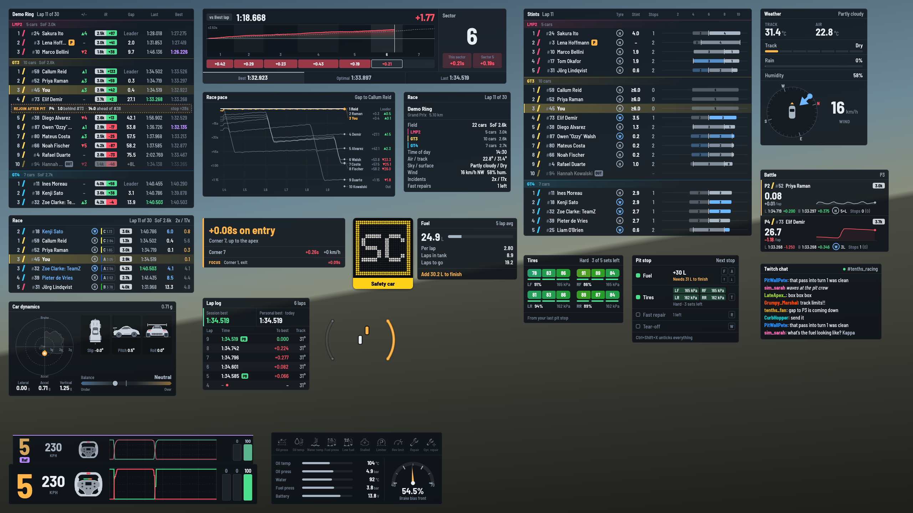

Every widget at once, in the demo race on a 2560×1440 screen. The default
layout turns on fewer, and you can place each one wherever you like.

<details>
<summary>The same layout in the light theme</summary>

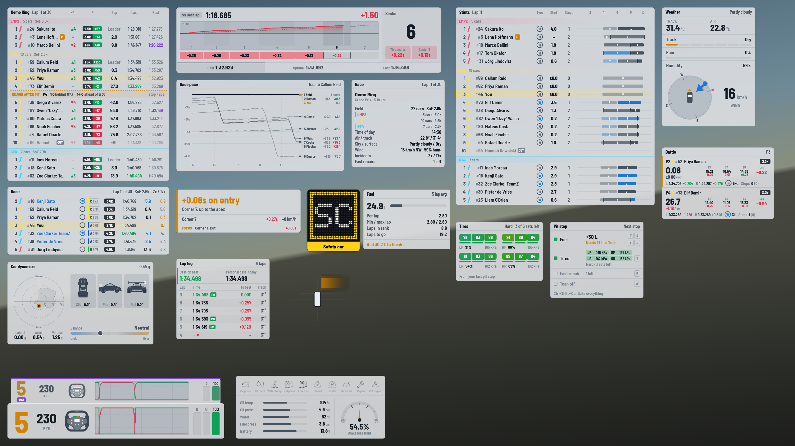

</details>

<details>
<summary>The same layout in the Box Box theme</summary>

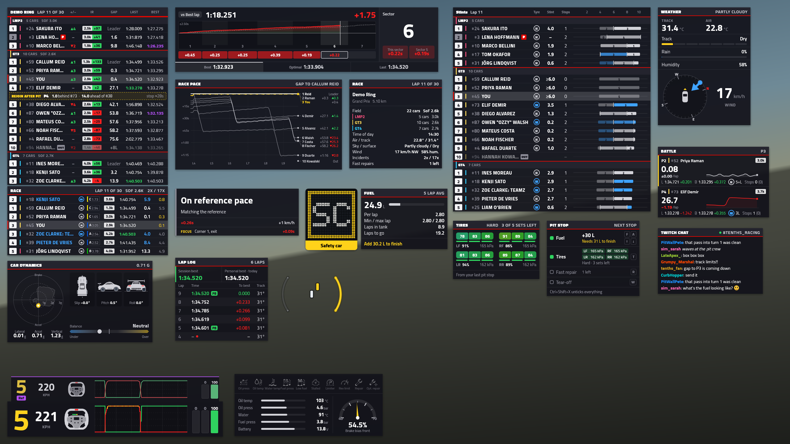

</details>

## Features

- **17 widgets**: timing tables, a race pace chart, everyone's stints, a lap
  delta graph, a lap log, live coaching, inputs, car dynamics, dash lights, fuel, tires, pit stop,
  weather, a radar and an LED flag board. Each one has its own options.
- **Pit stop controls**: tick fuel (enough to finish, a full tank, or a few
  litres more or less), tires, fast repair and a tear-off for your next stop
  without opening iRacing's pit menu, and see what iRacing has ticked.
- **Your keys, your wheel buttons**: every shortcut can be changed, and any
  action can also go on a button on your wheel, button box or gamepad.
- **Edit layout mode**: drag any widget anywhere, resize it, snap it to the
  screen edges and other widgets, and turn widgets on or off from the edit bar.
- **Any screen**: with more than one monitor, put each widget on whichever
  display you like; drag it across in edit mode.
- **Saved layouts**: keep as many layouts as you like (sprint, endurance,
  streaming…), switch with `Ctrl+Shift+L`, `Ctrl+Shift+1`–`9` or a wheel
  button, and export them as files to back up or share.
- **Any screen size**: widgets are pinned to the nearest screen edge or the
  centre, so a layout made at 1080p lands in the same places at 1440p or 4K.
- **Three themes**: dark, light, and Box Box (panels styled like a TV timing
  tower), with a color picker for every color the overlays use, kept
  separately for each theme.
- **Reference laps and coaching**: import iRacing's `.blap`/`.olap` best laps or
  any lap from an `.ibt` telemetry file, then compare against it live with the
  delta graph, ghost inputs and live coaching cues.
- **Lap history**: every lap is logged with whether it was clean, and your
  personal best for each car and track is saved between sessions.
- **Strength of field** worked out with iRacing's own formula, per class.
- **Click-through**: the overlay never takes the mouse from iRacing, except
  while you're editing the layout.
- **A demo race** with 21 cars in three classes, so you can set everything up
  without iRacing running.

## Widgets

Every widget can be shown or hidden, resized from 50% to 300%, faded, and moved
anywhere. Options are under **Settings → (widget name)**.

### Relative

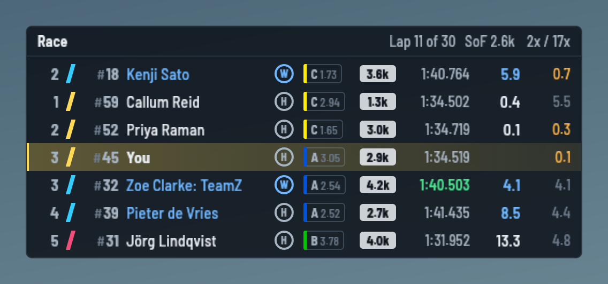

The cars just ahead of and behind you on track, with the time gap to each. Cars
a lap up on you are orange, cars you're lapping are blue. Each row has the
class color, car number, license and safety rating, iRating and last lap. A
last lap is purple when it's the fastest in class and green when it's that
driver's personal best. The last column is each car's gap to the car directly
in front of it on track (yours included), amber when it's under a second, so
you can see the fights going on around you. A car in the pit lane has an
outlined **P** next to its name, and a solid **P** once it's stopped in its
pit box. Cars that have left the sim aren't on track, so they drop out of the
relative. The header shows the lap count and your class's strength of field. When
there's a choice of tyres, a badge shows the compound each car is on (W wet, S
soft, M medium, H hard).

The header also shows your incidents against the limit, for example **4x /
17x**: amber from three quarters of the way, red within 4x. In series that
give a penalty at the limit and carry on, the limit moves on after it (18x /
21x, then 25x…); how many incidents apart those are is set in the widget's
options (4 by default, 0 when the limit is the end).

*Options*: how many cars ahead and behind, and whether to show iRating,
license, last lap, the gap to the car ahead, cars in the pits and SoF, when to show
the tyre column, incidents, and the step between penalties after the limit.

### Standings

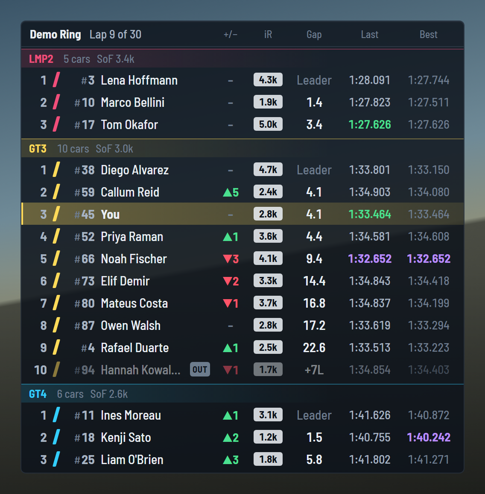

The race order grouped by class, with each class's car count and strength of
field. Your class shows more rows, and you're always kept in view. Gaps are to
the class leader or to the car ahead, with iRating, last and best laps.

In races, the **+/−** column shows how many places each car has gained (green
▲) or lost (red ▼) in its class since the start. The grid is the order on
track before the green flag; if you join a race already under way, the
qualifying order stands in.

In official races, each driver's iRating badge also shows their estimated
gain (green) or loss (red) if the race finished as it stands, worked out within
each class. iRacing doesn't
publish its formula, so this uses the community calculator other overlays use
(the "iRacing SOF iRating Calculator"); it's usually within a few points.

**Rate drivers.** Once you've taken the chequered flag, a **Rate** column
appears with a thumbs up and a thumbs down by every other driver. They're
white until you click one, then green or red; click it again to clear it.
Clicking works without edit mode: the overlay takes the mouse only while it's
over the thumbs, so everything else still goes to iRacing. Ratings are kept in
`driver-ratings.json` and, in later sessions, a small green or red thumb sits
next to that driver's name in the Standings and the Relative.

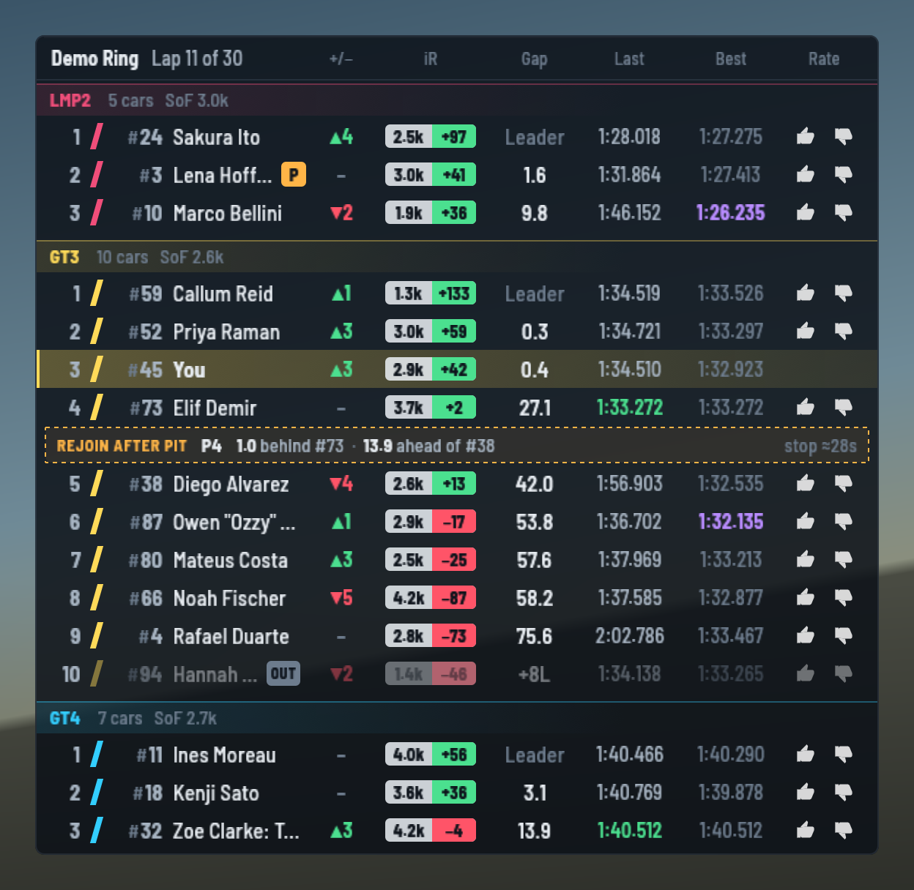

Next to the name, an outlined **P** means the car is in the pit lane and a
solid **P** that it's stopped in its pit box. A car that has left the sim gets
**OUT** in a race (retired, quit or towed to the garage) and **GAR** in
practice and qualifying, and its row fades.

**Rejoin after pit** (races): once a few pit stops have been timed this session, a
dashed line in your class shows where you'd come out if you pitted now: the
position, how far behind the car ahead you'd be and how far ahead of the car
behind. Tenths times every car's stops (pit entry to exit, minus the time
the same stretch takes at racing speed) and uses your class's average, so
nothing shows until at least two real stops in your class have been timed.
Drive-throughs, tows, resets to the pits and unusually long or short stops are
left out. The estimate
assumes a typical stop; a longer fuel fill or repairs mean you'd come out
further back. It's hidden while you're in the pit lane.

*Options*: rows for your class and for others, your class only, gap to leader
or interval, which columns to show (including places gained or lost), and the
pit rejoin line.

### Session

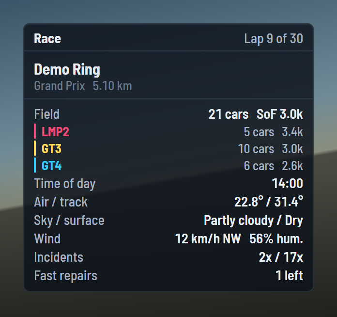

Everything about the event in one panel: track and length, field size with
cars and SoF per class, time of day, air and track temperature, sky, track
wetness, wind and humidity. At the bottom are your incidents against the limit
(amber from 75% of it) and how many fast repairs are left. Off by default.

*Options*: list each class, show conditions, show incidents and fast repairs.

### Delta

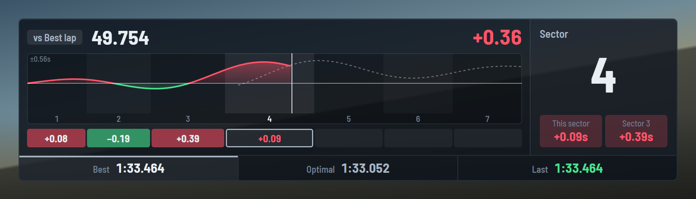

Your lap against a comparison lap, all the way round. The line rises where the
comparison lap is faster and dips where you are, so red above the line is time
lost and green below it is time gained. Last lap's line is dashed behind it.
Below that, each sector's gain or loss, and on the right the sector you're in.
Your best, optimal and last laps run along the bottom, with the comparison lap
highlighted.

Compare against your best lap, optimal lap (best sectors), session best,
session optimal, last lap, or an imported reference lap.

*Options*: comparison lap, iRacing's sectors or 4–30 equal mini sectors, last
lap's line, the lap times row, and a **simple pace readout** that swaps the
graph for one big number: how far ahead or behind you are right now.

### Race pace

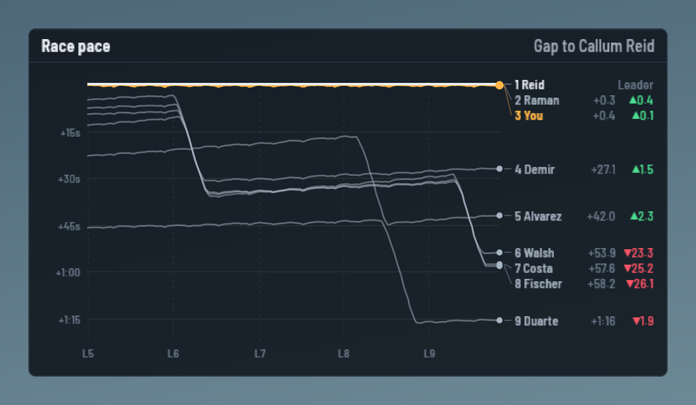

Everyone in your class against the class leader, through the race. The
leader is the flat line along the top; every other car is a line below it at
its gap to the leader, live. A line that slopes down is a car slower than the
leader, one that rises is catching, and the steeper it is the bigger the
difference in pace, so you can see at a glance who is quick, who is fading
and where the fights are. You're picked out in amber. Down the right, each
car's position, gap and how much the gap changed over the leader's last lap
(green when it's catching, red when it's dropping back). Lapped and retired
cars run along the bottom so they don't squash everyone else. Dotted lines
mark the leader's laps. The history starts when the race does (or when
Tenths starts, if that's later) and is kept while the widget is hidden. Races
only; off by default.

*Options*: the whole race or the leader's last 5, 10 or 20 laps; everyone in
your class or just the leader and the cars around you; a fixed gap scale; and
the gap change per lap.

### Stints

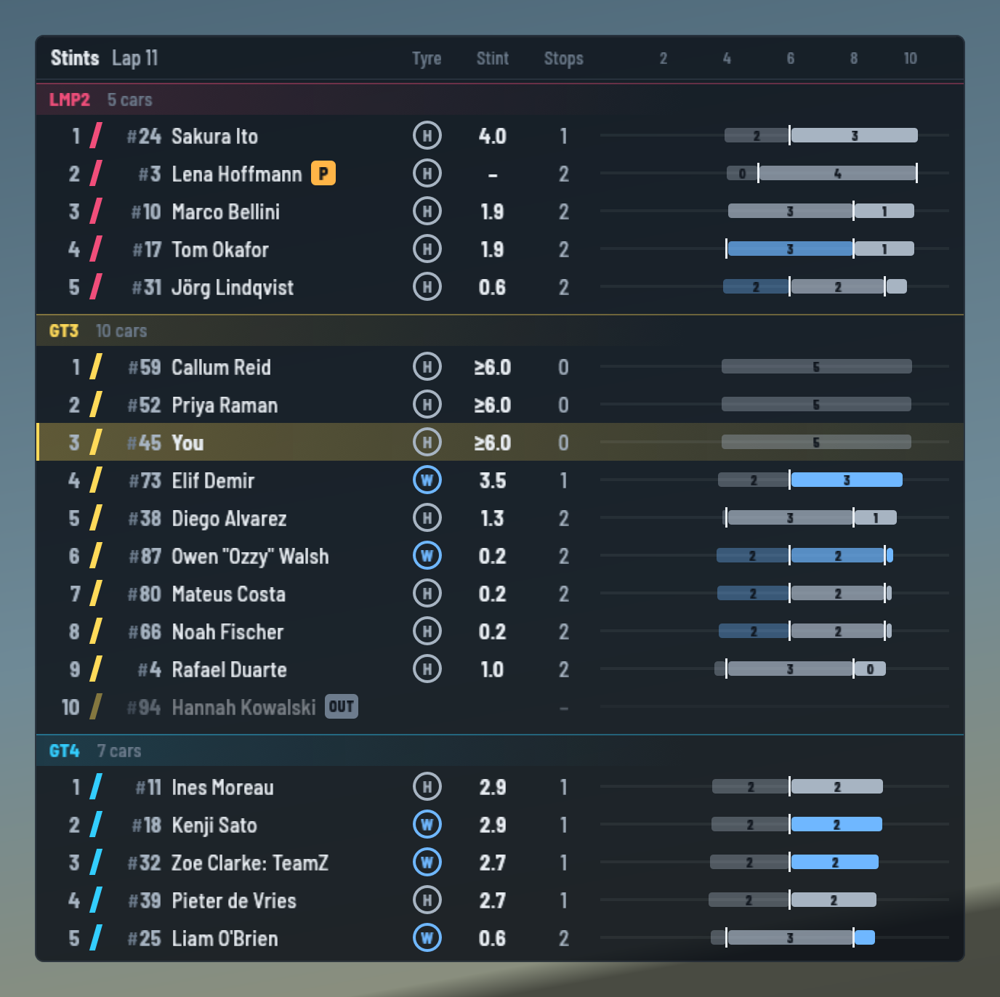

Every driver's stints, grouped by class in race order. **Stint** is how many
laps they've done since their last stop, live; **Tyre** the compound they're
on (shown when the car has more than one), and **Stops** how many times
they've been into the pit lane. The timeline runs across the whole session:
each stint is a bar coloured by compound (wets blue, softs red, mediums
yellow, hards light), with its length in laps written on it and a tick at
every stop, so you can see who's due in, who's gone long and who's switched
to wets. A ✕ marks a car that retired.

iRacing doesn't publish stints, so Tenths works them out from each car's
pit-lane visits and laps, from when it first sees the session. A stint it
only saw part of is faded and its length shown as "≥". It can't tell whether
another car changed tyres at a stop, only what compound it's on, so a
fuel-only stop still starts a new stint. Off by default.

*Options*: all classes or just yours, rows for your class and for others,
the timeline, stint lengths on it, and when to show the tyre column.

### Lap log

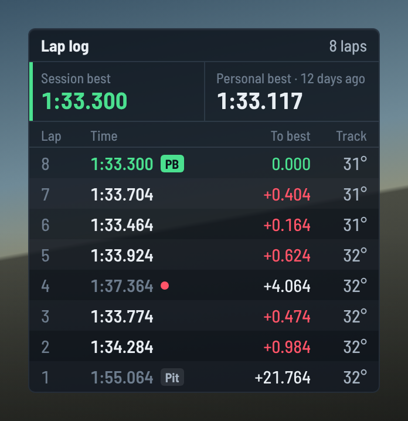

Every lap this session, newest first, with its gap to your best and the track
temperature when you set it. Your session best is green. A red dot marks a lap
that wasn't clean (off track or an incident), "Pit" marks in and out laps, and
"PB" marks a lap that beat your all-time personal best. The header shows the
session best and your personal best for this car and track, with when you set
it. It shows 8 laps; older ones scroll below, with a fade at the bottom when
there are more. While you drive the overlay lets the mouse through to the
game, so scroll the list in edit layout mode.

*Options*: how many laps to show before the list scrolls, gap to session best
or to personal best, and the gap, temperature and fuel-used columns.

### Coach

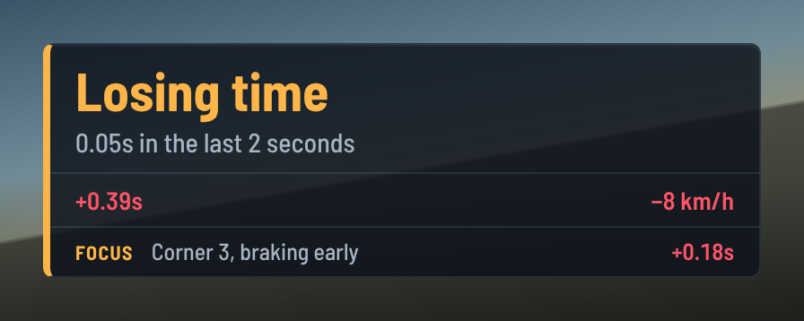

One live cue at a time from an imported reference lap: brake or lift in 50 m,
brake now, you're braking early, brake harder or lighter (measured from your
own brake point, so braking late isn't mistaken for braking lightly), trail
the brake, carry more speed, throttle now, gear at the apex, turn in more, and
whether you're gaining or losing. As you leave each corner it gives a verdict:
the time you gained or lost there and the main reason, like "Braked 20 m
early" or "Throttle earlier". Below it, your gap to the reference and your
speed difference, and the focus corner: the one costing you most on average,
and why. Corners where you're consistently on pace stop getting minor cues,
and coaching pauses under yellow and off track. Only shown while a reference
lap for this track is loaded.

*Options*: show the reason line, the gap and speed, and the focus corner.

### Inputs

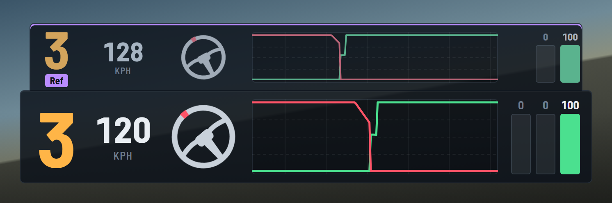

Gear, speed, a steering wheel that turns with yours, a scrolling throttle and
brake trace, and throttle, brake and clutch bars. The gear turns red at the
shift point. With a reference lap loaded, a slimmer strip above shows the
reference's gear, speed, pedals and (for `.ibt` laps) wheel at the same spot on
track.

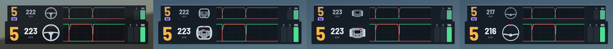

The wheel comes in four styles: round (road cars), GT, formula and oval. The
GT and formula wheels have shift lights that fill green, amber and red as you
near the shift point. *Automatic* picks one from the car's name (formula and
prototype cars get the formula wheel, GT cars the GT wheel, stock cars and
short-track cars the oval wheel, anything else the round one).

*Options*: trace length, wheel style, and whether to show the trace, wheel,
clutch, shift light and reference strip.

### Car dynamics

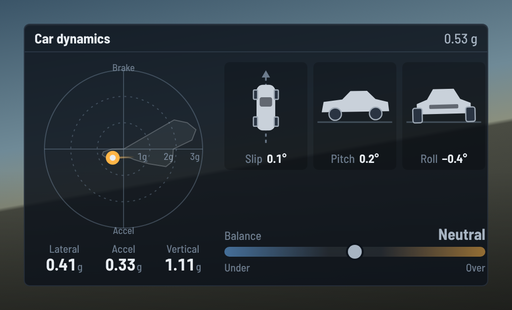

A g-meter with the grip you've been using drawn around it: each point of the
outline holds for 10 seconds, then shrinks back to the centre over the next
10, so it shows recent grip and fades away on the straights. Beside it are the
lateral, longitudinal and vertical g, top, side and rear views of the car
showing slip, pitch and roll, and a balance bar estimating understeer or
oversteer from how the car rotates for the steering you put in.

*Options*: g-meter range, how long the grip outline holds and how quickly it
shrinks back to the centre, which way the dot moves, slip/pitch/roll views and
how much to exaggerate them, and the balance bar. With the views and the
balance bar both off, it's just a narrow g-meter.

### Instruments

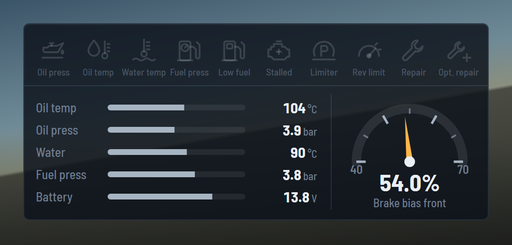

Dash lights for every iRacing engine warning (oil and fuel pressure, oil and
water temperature, stalled, pit limiter, rev limiter, repairs) plus a low fuel
light, engine gauges, and a brake bias dial that flashes when you change it.

*Options*: engine gauges, brake bias, and a bulb test that lights every warning
while editing.

### Fuel

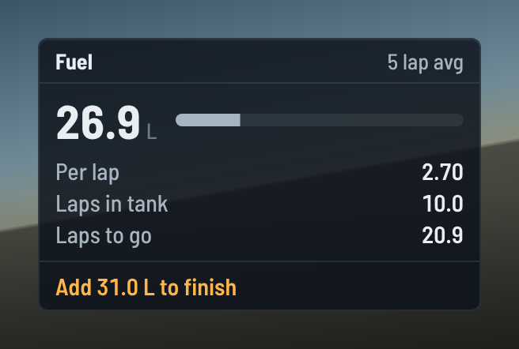

Fuel in the tank, use per lap (the average of your last 5 green laps), laps
the tank will last, laps to go, and how much to add at your stop to finish.
In timed races, laps to go runs until the overall leader takes the flag (the
white flag once the clock runs out, then one more lap), so it never leaves you
a lap short if you're behind the leader.

*Options*: a safety margin in laps.

### Weather

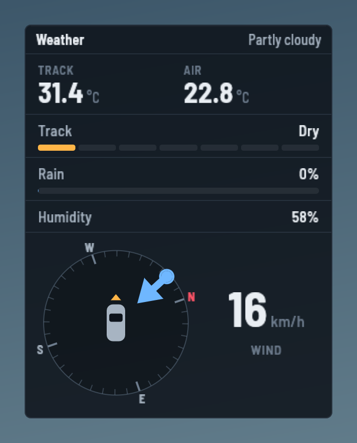

Track and air temperature, how wet the track is (iRacing's seven steps from
dry to extremely wet), rain, humidity and fog, with arrows showing which way
each has moved over the last three minutes. Below, a wind compass that turns
with your car: the car always points up and the arrow shows where the wind is
hitting you from, with the wind speed beside it. iRacing
doesn't publish a forecast or rain radar, so the trend arrows are the closest
thing to one. Wind is measured at the start/finish line. Off by default.

*Options*: show the compass, turn it with the car or keep north up, and the
trend arrows.

### Tires

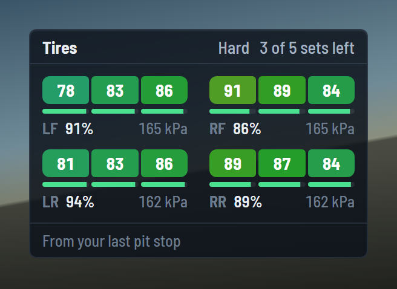

Temperature across each tire (inside, middle, outside), tread left, cold
pressures, the compound and how many sets you have left.

*Options*: show cold pressure.

### Pit stop

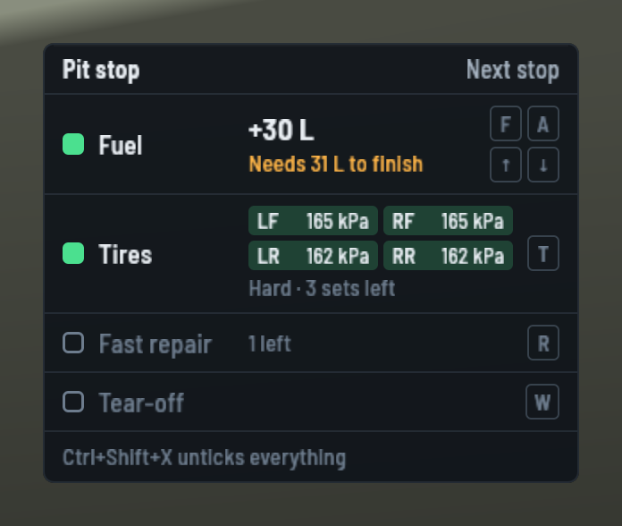

What iRacing will do at your next stop, and keys or wheel buttons to change it
while you drive. Each one changes one item in iRacing's pit menu. These are the
default keys; put them on other keys or on buttons in
[Settings → Controls](#controls):

| Default key          | Does |
| -------------------- | ---- |
| `Ctrl + Shift + F`   | Fuel: the amount to finish (from the Fuel widget, with its safety margin), or a full tank. Press again to untick it, or to update it once the amount has changed. |
| `Ctrl + Shift + ↑` `↓` | A few litres more or less (5 by default). Quick presses add up. |
| `Ctrl + Shift + T`   | All four tires, or untick them |
| `Ctrl + Shift + R`   | Fast repair |
| `Ctrl + Shift + W`   | Windscreen tear-off |
| `Ctrl + Shift + X`   | Untick everything |

iRacing never confirms a command, so each row shows what iRacing reports as
ticked, not what was asked for. The fuel line turns amber when the amount
ticked doesn't match what you need. Pressures are the ones iRacing will set,
and the header says if you've stopped too far from your box. The keys and
buttons only work while this widget is on and you're in the car, so they don't
take `Ctrl+Shift+T` and the rest from other programs the rest of the time. Each
row shows its key, or its wheel button if it has one, and lights it up for a
moment when you press it. Off by default.

*Options*: what the fuel key adds (enough to finish, a full tank, or the
amount already set in iRacing), how much more or less fuel changes it, set
fuel automatically as you enter the pits (skipped if you've changed it by
hand), and show the keys.

### Radar

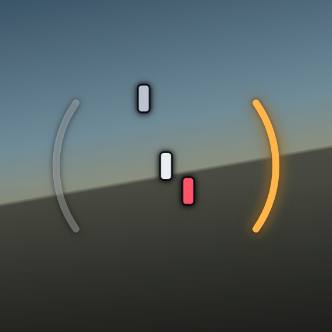

A see-through top-down view of the cars around you. Cars turn amber when
they're close and red when they overlap, and the side arcs light up when
someone's alongside.

*Options*: range, always visible or only when a car is near, and class colors.

### Flags

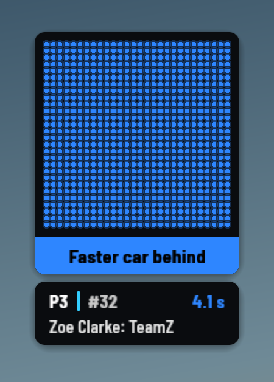

A trackside LED flag board. Yellow (flashing when waved), safety car ("SC" in a
yellow border), blue (flashing), debris, white, chequered, red, black, meatball,
black-and-white warning and disqualified each have their own pattern. Green
shows for a few seconds after a start or restart. Under the lights, a bar in
the flag's color says what it means.

*Options*: the text for each flag (for example "Accident ahead" for yellow), up
to three letters for the safety car board, how long green shows, and whether
the empty board stays visible.

## The app

Tenths runs in the background with an icon in the system tray. It has two
windows: the **overlay**, a transparent window over each of your monitors that
holds the widgets and lets every click through to iRacing, and the **settings**
window, where everything below is set. Settings apply as soon as you change
them; there's no Save button.

The **tray icon** opens the settings window with a left click. Its right-click
menu has Open settings, Edit layout, Show / hide overlays and Next layout (each
with its current key), and Quit Tenths. Closing the settings window only hides
it; Tenths keeps running until you quit it from the tray.

Along the top of the settings window are the connection status (Waiting for
iRacing, Connected to iRacing, or Demo race running), **Hide overlays** and
**Edit layout**. Down the side are the General, Layouts, Appearance and
Controls pages, then a page for each widget with a dot showing whether it's on.

### General

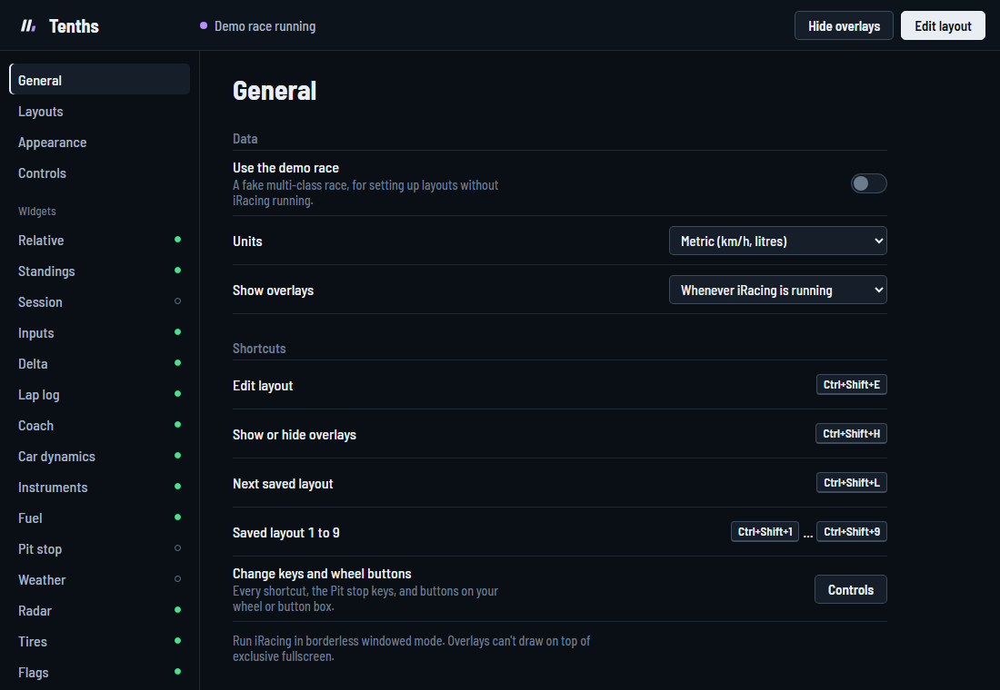

| Setting | Does |
| ------- | ---- |
| **Use the demo race** | A fake 21-car, three-class race instead of iRacing, for setting up layouts without the sim running. |
| **Units** | Metric (km/h, litres, °C, kPa and bar) or imperial (mph, gallons, °F and psi), for every widget. |
| **Show overlays** | Whenever iRacing is running, or only while you're in the car. In edit mode they always show. |
| **Shortcuts** | The keys for editing the layout, showing and hiding the overlays and switching layouts, with a button to change them under Controls. |
| **Size of every widget** | Sets every widget to 75%, 100%, 125%, 150% or 200% at once. At 1440p, 125% looks about the same as 100% at 1080p. |
| **Widgets** | An on/off switch for every widget. |
| **Reset layout** | Puts every widget back to its default size, position and options. Theme, colors, keys and saved layouts are kept. |

### Layouts

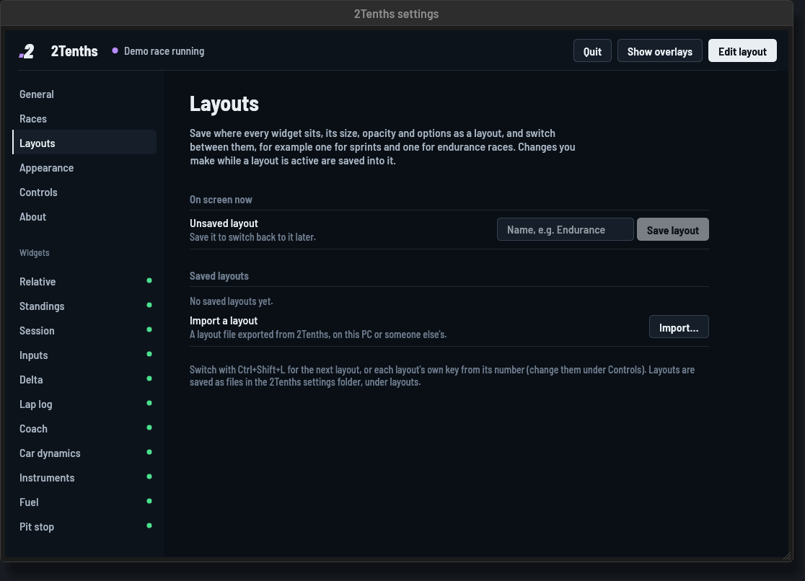

A layout is every widget's position, size, opacity, on/off state and options,
saved under a name: one for sprints and one for endurance races, say, or one
for streaming. The theme, colors, units and keys stay the same across layouts.

- **Save**: give what's on screen a name and **Save layout**. While a layout is
  on screen (marked **On screen**), anything you change, whether moving,
  resizing, options or showing and hiding widgets, is saved into it. **Save as
  new** copies it under another name.
- **Switch**: **Switch to** on the list, the picker in the edit bar, the next
  layout key (`Ctrl+Shift+L`), or a layout's own key by its number in the list
  (`Ctrl+Shift+1` to `9`). Any of these can be wheel buttons too. The overlay
  shows the layout's name for a moment.
- **Rename**, **Duplicate** and **Delete** (it asks once more) from the list.
- **Export** saves a layout as a `.json` file, and **Import** adds one, so
  layouts can be backed up or shared. Importing never overwrites a layout you
  already have.

### Appearance

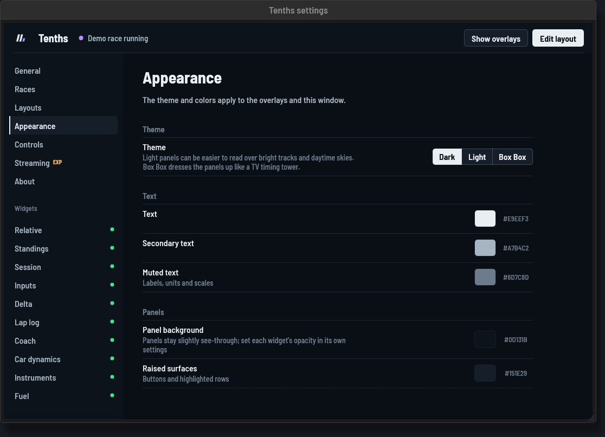

Three themes:

- **Dark**: dark see-through panels, the default.
- **Light**: the same panels in a light shade, which can be easier to read over
  bright tracks and daytime skies.
- **Box Box**: dressed up like a TV timing tower, with near-black see-through
  panels with square corners, Titillium Web type, a broadcast-red line under
  each heading, positions in white boxes (red outside the top ten, grey in the
  pits), names in bold capitals and straight class stripes.

Below the theme is a color picker for every color the overlays use: text (main,
secondary and muted), panels (background, raised surfaces, borders, and the
steering wheel and car), timing (fastest in class, gaining and personal best,
losing time, warnings, cars you're lapping and cars lapping you) and the pedals
(throttle and brake follow gaining and losing until you change them, and the
clutch). Each theme keeps its own colors, each color has a **Default** button,
and **Reset colors** puts the whole theme back. Shades such as the reference
lap's muted colors are mixed from these, so they follow your changes. Class
colors come from iRacing, and the flag board uses real flag colors. The theme
and colors apply to the settings window too.

### Controls

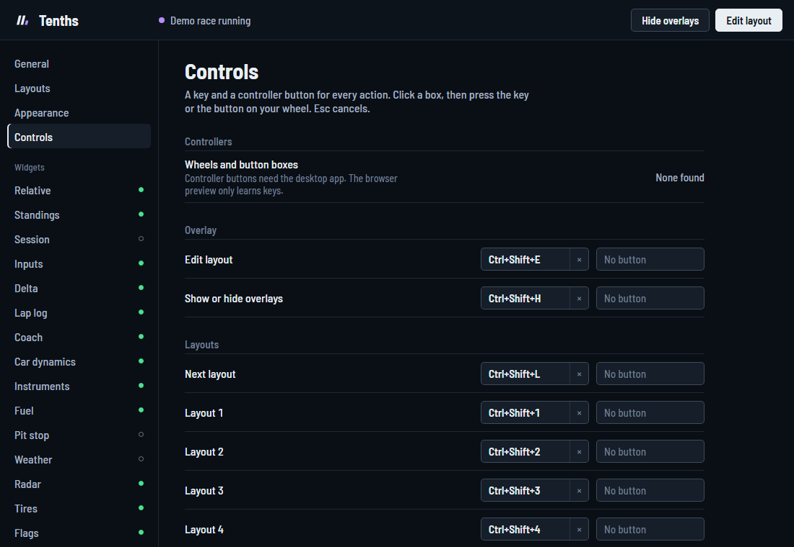

Every action has a key and a controller button:

| Group | Actions |
| ----- | ------- |
| Overlay | Edit layout, show or hide overlays |
| Layouts | Next layout, layout 1 to 9 |
| Pit stop | Fuel, more fuel, less fuel, four tires, fast repair, tear-off, untick everything |

Click a box and press the key, or the button on your wheel, button box or
gamepad. `Esc` cancels and × clears it; so does clicking away, closing
Settings, or waiting 15 seconds. Nothing else fires while it's waiting, so you
can choose a key that's already in use. Two identical button boxes are told
apart by the USB port they're in. It warns when two actions share
a key or button, when a key has no Ctrl, Alt or Shift (it would stop working in
other programs while Tenths runs; F13 to F24 are fine, since keyboards don't
have them), and when a bound controller isn't plugged in. The top of the page
lists the controllers Tenths can see. **Restore defaults** puts back the
`Ctrl+Shift` keys and clears every button.

Controller buttons are read with Windows Raw Input, so they work while iRacing
has the focus, and every button counts, not just the first 32. A hat switch
(the d-pad on most wheels) works as four buttons. Buttons are remembered by the
device's hardware id, so they keep working on another USB port. To see which
controllers Tenths finds, run
`cargo test -p tenths list_controllers -- --ignored --nocapture`.

### Widget pages

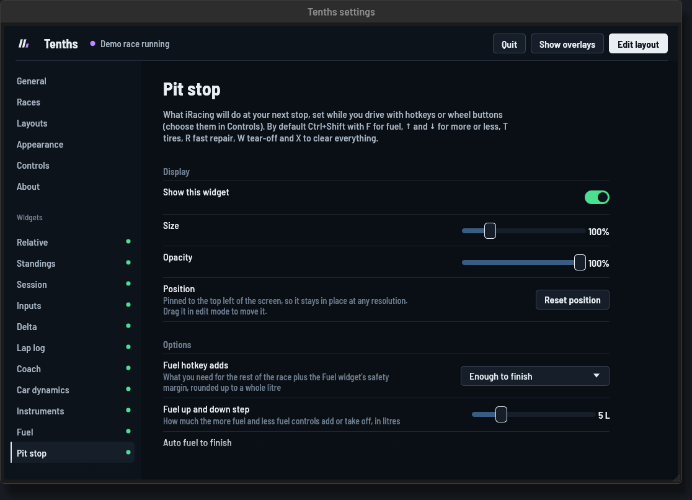

Each widget has its own page, opening with what it shows:

| Setting | Does |
| ------- | ---- |
| **Show this widget** | Turns it on or off. **Hide** on its label in edit mode does the same. |
| **Size** | 50% to 300%. Dragging its corner in edit mode does the same. |
| **Opacity** | 20% to 100%, for the whole widget. |
| **Screen** | With more than one monitor: which display it's on. |
| **Position** | Which edge of the screen it's pinned to. **Reset position** puts it back where it starts, on the main display at 100%. |
| **Options** | The widget's own options, listed with each widget [above](#widgets). Drop-downs explain the choice that's picked. |
| **Reset options** | Puts its options back to their defaults. |

The Delta page also has **Reference lap and coaching**, for importing the lap
the Delta, Coach and Inputs widgets compare you with (see below).

## Reference laps

The Delta, Coach and Inputs widgets can compare you with a lap you import
under **Settings → Delta → Reference lap and coaching**:

- **`.blap` / `.olap`**: iRacing's saved best and optimal laps, from
  `Documents\iRacing\lapfiles`. These don't record steering, so there's no
  reference wheel; line cues use the car's heading instead.
- **`.ibt`**: iRacing telemetry files (record with `Alt+L`). Pick any complete
  lap; these include steering.

A reference is only used when its track and layout match the session.

## Notes

- iRacing only updates tire temperatures and wear while your car is in its pit
  box. On track, the Tires widget shows the reading from your last stop.
- Low fuel is worked out by Tenths: under 2 laps of fuel, or under 8% of the
  tank before there's a per-lap figure.
- Gauges a car doesn't model read "–", and so does brake bias on cars without
  an adjustable bias.
- SoF uses iRacing's formula over every entry in the class, including cars
  that aren't on track, so Relative, Standings and Session always agree.
- The shift point is where the car's own shift lights start blinking in the
  current gear (or are all lit, for cars without a blink point). Turn off
  **Inputs → Gear turns red to shift** to keep the gear yellow.
- iRacing doesn't publish an optimal lap time, so the Delta panel's Optimal
  adds up your best clean sectors this session. It can differ from the
  all-time optimal in iRacing's own lap files.
- A lap counts as clean when you stay on track, off pit road and pick up no
  incidents. Only clean laps count for session and personal bests. Lap times
  are iRacing's own, or Tenths' timing if iRacing doesn't report one.
- In team events, the Session panel counts the team's incidents, since that's
  what the limit applies to.

## Install and run (Windows)

One-time setup:

1. Install the [Microsoft C++ Build Tools](https://visualstudio.microsoft.com/visual-cpp-build-tools/)
   with the "Desktop development with C++" workload.
2. Install Rust from [rustup.rs](https://rustup.rs) (the default MSVC toolchain).
3. Install [Node.js](https://nodejs.org) 20 or newer, and [Git](https://git-scm.com).
4. WebView2 is already on Windows 10/11. If it's missing, install the Evergreen runtime.

Then:

```powershell
git clone https://github.com/scarnegie96/Tenths-iRacing-Overlay.git
cd Tenths-iRacing-Overlay
npm install
npm run tauri dev      # run with hot reload
npm run tauri build    # installer in target\release\bundle\nsis\
```

In iRacing, set the display mode to **borderless windowed**. No overlay can draw
over exclusive fullscreen.

Quit Tenths from its tray icon before running `npm run tauri build`. If a copy
started from `target\release\tenths.exe` is still open, Windows locks the file
and the build stops with "Access is denied". Running the installer instead
puts Tenths in its own folder, so it can stay open while you build.

### Updates

Tenths checks GitHub for a new release a little after it starts, then every six
hours. When there is one, **Settings → About** shows the version and its notes
(the tray's **Check for updates** item becomes **Update to …**). Nothing
installs until you click **Update to …**: Tenths downloads the installer,
checks its signature, closes for a few seconds while it installs, then opens
again. Your settings, layouts and lap history stay where they are. Automatic
checks can be switched off on the same page.

Only installers signed with the project's private key are accepted, so an
update can't be swapped for something else on the way. Copies built on your
own PC still check and install releases the same way.

### Making a release

Releases are built on GitHub (`.github/workflows/release.yml`), so nothing needs
building locally.

1. Set the same version in `package.json`, `src-tauri/Cargo.toml` and
   `src-tauri/tauri.conf.json`, and commit it.
2. Tag the commit with the release notes as the tag's message, and push the tag:
   ```powershell
   git tag -a v0.4.2 -m "- What changed`n- Another change"
   git push origin v0.4.2
   ```
3. GitHub Actions builds the installer on Windows, signs it for the updater and
   publishes the release with `Tenths_<version>_x64-setup.exe`, its `.sig` and
   `latest.json`. Running copies of Tenths see it at their next check.

The build stops early if the tag doesn't match the app version, or if the
repo's signing setup is missing.

The installer isn't code-signed for Windows (that's a separate, paid
certificate), so SmartScreen asks people to click **More info → Run anyway**
the first time they install by hand.

## Using it

The overlay covers every monitor and lets every click pass through to
iRacing (see [The app](#the-app) for the tray icon and settings window). These
are the default keys; change them, or put them on wheel buttons, under
[Controls](#controls).

| Default key              | Does |
| ------------------------ | ---- |
| `Ctrl + Shift + E`       | Edit layout. `Esc` finishes. |
| `Ctrl + Shift + H`       | Show or hide all overlays |
| `Ctrl + Shift + L`       | Next saved layout |
| `Ctrl + Shift + 1`…`9`   | Saved layout by its number |
| `Ctrl + Shift + F` `↑` `↓` `T` `R` `W` `X` | Pit stop: fuel, more, less, tires, fast repair, tear-off, untick everything (see [Pit stop](#pit-stop)) |

### Editing the layout

- Drag a widget to move it. Drag its corner, or use − and +, to resize it.
- Widgets snap to the screen edges and to each other while you drag.
- **Hide** on a widget's label turns it off. **Widgets** in the edit bar lists
  every widget, to turn any of them back on.
- The picker in the edit bar switches saved layouts.
- Each widget is pinned to its nearest screen edge or the centre, so a layout
  made at 1080p lands in the same places at 1440p or 4K. Resizing grows a
  widget away from the edge it's pinned to.
- **More than one monitor**: every display gets its own overlay and edit bar.
  Drag a widget past the edge of one screen and let go on another to move it
  there ("Release to move to display 2" shows while you're over it), or use
  the **⇥ 2** button on its label to send it to the next display, where it
  keeps its place relative to the screen edges. Settings has a **Screen**
  choice per widget too. Plugging in, unplugging or rearranging monitors is
  picked up within a couple of seconds. A widget whose display isn't
  connected shows on the main one until it's back. Displays are numbered
  main first, then left to right.
- On a 1440p screen at 100% Windows scaling, set every widget to 125% to get
  about the size they'd have at 1080p (**General → Widgets** sets them all at
  once). If Windows scaling is already 125%, leave them at 100%.

Turn on **General → Use the demo race** to lay things out without iRacing
running. **General → Reset layout** puts everything back to the defaults.

### Where things are saved

Everything is in `%APPDATA%\dev.tenths.overlay\`:

| File or folder   | Holds |
| ---------------- | ----- |
| `config.json`    | Settings, theme, colors, keys and buttons, and the widgets on screen |
| `layouts\`       | Saved layouts, one `.json` file each |
| `laps\`          | Lap history and personal best, one file per car and track |
| `reference.json` | The imported reference lap |
| `driver-ratings.json` | Your thumbs up or down on other drivers, by iRacing id |

If `config.json` can't be read, Tenths keeps it as
`config.corrupt-<date>.json`, starts with default settings and says so in
Settings.

## Working on it from a Mac or Linux

The front end runs in a normal browser with a fake 21-car, 3-class race, so you
can work on widgets anywhere:

```bash
npm install
npm run dev
```

Open `http://localhost:1420/overlay.html` and `http://localhost:1420/settings.html`
side by side. The two tabs stay in sync. On the overlay, `E` edits the layout,
`L` switches saved layouts and `F` steps through every flag. With the Pit stop
widget on, `Shift` + `F`, `↑`, `↓`, `T`, `R`, `W` or `X` stand in for its keys. These
URL parameters help too:

| Parameter       | Does |
| --------------- | ---- |
| `?speed=6`      | Fast-forwards the fake race |
| `?warmup=150`   | Races 150 seconds before the first frame, so graphs and traces are full |
| `?reference`    | Starts with a reference lap loaded, for the Coach and reference inputs |
| `?flag=16384`   | Starts with a flag out (iRacing's flag bits; 16384 is a caution) |
| `?theme=light`  | Shows the light theme (`?theme=f1` for Box Box) |
| `?shot=delta`   | Draws one widget on its own, for screenshots |
| `?pane=controls` | Opens the settings window on a page (`general`, `layouts`, `appearance`, `controls`, `about` or a widget's id) |
| `?sample`       | Fills the settings window with a few saved layouts, for screenshots |
| `?all`          | Turns every widget on, laid out for a 2560×1440 window (the overview screenshots) |
| `?pits`         | Keeps one GT3 car in the pit lane, so the pit symbol shows |
| `?displays=2`   | Adds a second display; `&display=2` makes the tab that display's overlay |
| `?finished`    | You've taken the flag: the Standings shows the thumbs for rating drivers |
| `?update`      | Settings → About: **Check now** finds a pretend newer version, and installing it shows the progress |
| `?corrupt`     | Settings shows the notice for a settings file that couldn't be read |

To regenerate the README screenshots, keep `npm run dev` running and run
`node scripts/screenshots.mjs`. It uses Edge or Chrome, headless.

The Tauri app builds only on Windows, but the core crate builds anywhere:

```bash
cargo test -p telemetry                                    # engine and parser tests
cargo check -p telemetry --features typecheck-windows      # type-check the Windows SDK reader
cargo run -p telemetry --example dump                      # print demo-race output as JSON
cargo run -p telemetry --example radar                     # what the radar sees, once a second
cargo run -p telemetry --example make_ibt -- demo.ibt      # write a demo .ibt to try importing
cargo run -p telemetry --example inspect_lap -- lap.blap   # list the corners the coach finds in a lap
cargo run -p telemetry --example coach_demo                # how often each cue fires in the demo
cargo run -p telemetry --example stints_demo               # every demo car's stints and pit loss after 12 minutes
cargo run -p telemetry --example timed_finish -- race.ibt  # flags and time left at the end of a timed race
```

Before committing, run `npm run build` (type-checks the front end), `npm run lint`
and `cargo clippy --workspace --all-targets`. Layout validation, the
iRating estimate and the incident limits have their own checks: see the top of
`scripts/check-config.ts`, `scripts/check-irating.ts` and `scripts/check-incidents.ts`.

## Project layout

```
crates/telemetry/     Pure Rust, no Tauri. Everything about iRacing data.
  irsdk.rs            Shared-memory reader (our own, about 300 lines)
  session.rs          Session YAML parser, tolerant of iRacing's quirks
  engine.rs           Relative gaps, standings, fuel maths, SoF, deltas, optimal lap
  grid.rs             Starting grid for places gained/lost, and each car's pit or garage status
  stints.rs           Every car's stints: laps between stops, tyre compound, stops
  pitloss.rs          Times every pit stop: the session's average loss per class
  laps.rs             Lap log and personal bests, saved per car and track
  vars.rs             Variable header parsing shared by live data and .ibt files
  ibt.rs              .ibt telemetry file reader: finds complete laps
  blap.rs             iRacing .blap/.olap reader (best/optimal lap files)
  reference.rs        Imported comparison lap: time, speed, pedals, gear, steering, line
  coach.rs            Corners from the reference and the live coaching cues
  dynamics.rs         g-forces, slip, pitch, roll and the understeer/oversteer estimate
  instruments.rs      Engine warning lights, gauges, low fuel and brake bias
  pit.rs              Pit commands sent to iRacing, and what's ticked for the next stop
  demo.rs             Fake 21-car, 3-class race with a scripted battle for the radar
  runner.rs           Telemetry thread: 60 Hz tick, 10 Hz field
src-tauri/            Windows, tray, hotkeys, click-through, config file
  controls.rs         Which key or controller button runs which action
  controllers.rs      Wheel, button box and gamepad buttons, read with Raw Input
  profiles.rs         Saved layouts: list, save, import and export
  updates.rs          Checking for and installing new versions (updater plugin)
src/
  lib/                Types, config schema, themes, delta and race histories, weather and pit maths,
                      bridge to Rust (or browser mock)
  overlay/            Transparent overlay: drag, snap, resize, screen anchoring
  widgets/            One file per widget
  settings/           Settings window
scripts/              README screenshot generator
docs/ARCHITECTURE.md  How data flows, the maths behind each widget, adding a widget
```

See [docs/ARCHITECTURE.md](docs/ARCHITECTURE.md) for how data flows, how each
number is worked out, and how to add a widget.

## License

Tenths is free software: you can redistribute it and change it under the terms
of the [GNU General Public License](LICENSE) as published by the Free Software
Foundation, either version 3 of the License or (at your option) any later
version. In short: use it, change it and share it as you like, and if you share
a changed version, share its source under the same license. It comes with no
warranty.

The bundled fonts, Barlow Semi Condensed and Titillium Web, are under the SIL
Open Font License 1.1.

Tenths isn't affiliated with or endorsed by iRacing.com Motorsport Simulations,
LLC. iRacing is their trademark.
