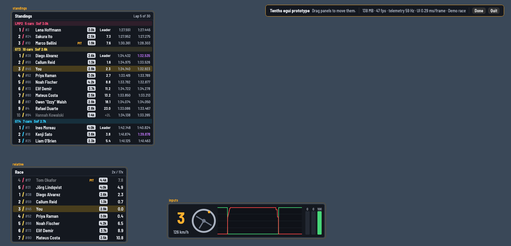

# Tenths egui prototype

A small test of drawing Tenths natively with [egui](https://github.com/emilk/egui)
instead of WebView2. It reuses the app's telemetry core (`crates/telemetry`)
unchanged, the same runner, engine and demo race, and draws three widgets:
**Standings**, **Relative** and **Inputs**.

The point is to measure memory and smoothness against the Tauri app. It isn't a
replacement yet: there are no settings, one display only, and fixed options.



## How it works

- One process, one transparent, always-on-top, borderless window over the
  primary display. Clicks go through to iRacing except while editing.
- The telemetry thread is the app's own `runner::spawn`, with a `Sink` that
  keeps the latest payloads in memory (`src/data.rs`). Nothing is serialised;
  each new frame asks egui to redraw, and egui merges those requests.
- Widgets are plain painting code (`src/widgets/*.rs`) in egui `Area`s, which
  are draggable in edit mode. egui remembers where you put them between runs.
- The Barlow Semi Condensed font is bundled (`assets/fonts`, SIL Open Font Licence).

## Run it

Windows: download `tenths-egui.exe` from the latest run of the
**egui prototype** workflow (GitHub → Actions → egui prototype → Artifacts),
or build it yourself (`cargo build --release` in this folder).

Close the Tauri app first: both use Ctrl+Shift+E.

```
tenths-egui.exe                  iRacing (waits for it)
tenths-egui.exe --demo           the demo race
tenths-egui.exe --edit           start in edit mode
tenths-egui.exe --imperial       mph
tenths-egui.exe --bench 600      print memory and frame stats every 10 s, quit after 600 s
tenths-egui.exe --shot out.png   save a screenshot after 5 s (--shot-after N), then quit
```

- **Ctrl+Shift+E** toggles edit mode (from anywhere). In edit mode, F2, Esc
  or **Done** finishes. Drag a panel to move it.
- **Ctrl+Shift+Q** or **Quit** in the edit bar closes it.
- The edit bar shows memory, frames per second, the telemetry rate and how
  long each frame takes to build.

## Comparing with the Tauri app

1. Run `tenths-egui.exe --bench 900` and drive 10 laps (or `--demo --bench 900`).
   It prints a line every 10 seconds.
2. Do the same 10 laps with the Tauri app and the same three widgets, reading
   Task Manager (Tenths plus its `msedgewebview2.exe` processes).

What to look for: total memory, whether it climbs, and CPU in Task Manager.

## Measured here (Linux, software rendering, demo race)

| | Value |
|---|---|
| Memory after 90 s | 133 MB, flat after the first seconds |
| UI time per frame | ~0.25 ms |
| Telemetry | ~59 Hz |

That's with Mesa's software OpenGL, which uses more memory than a real GPU
driver, so treat it as an upper bound until it's measured on Windows.

## Not done yet

Several displays, settings and options, themes, the other 16 widgets, the
tray icon, controller buttons, saved layouts from the main app, and click-through
regions (the post-race thumbs).
